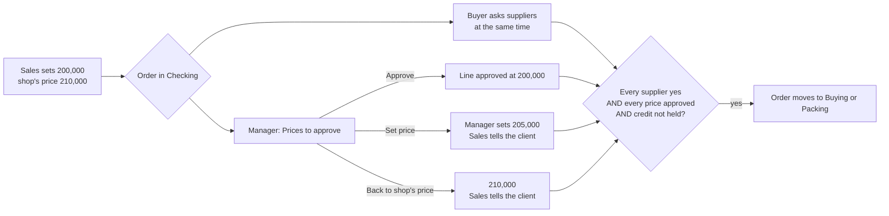

# Who decides what: decision rights for the Omni-Ware team

**Status: binding.** Agreed with the owner on 18 Oct 2026. This file is the
authority on who may decide what in every Omni-Ware app (index.html,
sales.html, buyer.html, store.html, manager.html, accounts.html) and in every
migration that writes `role_tasks`.

If code, a comment, a migration header or a line of UI text says "the owner"
for a decision this file gives to the Manager, **this file wins**. Correct the
other place in the same change. `test/decision-rights.test.js` holds the table
below against the migrations, so the two cannot drift apart silently.

---

## 1. The principle

| | Role | Job |
|---|---|---|
| 1 | **Owner** | Sets policy, sees everything, keeps the few decisions listed in section 4. **Gets a log, not a queue.** The owner never has to approve each order. |
| 2 | **Manager** | Runs the team on the owner's behalf. **Decides** prices, markups, credit, returns, voids and credit notes, stock write-offs, and each salesperson's goal. |
| 3 | **Sales, Buyer, Store, Accounts** | Do the work and **propose** exceptions. Nobody decides their own exception. |

Two hard rules hold for every role:

- **Nobody sells below cost** in a role app. Cost is the floor, and it is the
  only floor. Above it, the Manager has full price authority.
- **Every Manager decision is logged** with who, when and what it was before,
  so the owner can see it without approving it.

The old wording, "stays the owner's" (migrations 0083, 0113 to 0117), described
the first build, not the policy. Where it covers a row this file gives to the
Manager, it is out of date.

---

## 2. The decision table

`Who decides` lists the roles that hold the task. The owner and admins hold every
task through `has_task()` (0113) and are not listed. `Built` says whether the
task is in `role_tasks` yet: **yes** means a migration grants it to every role
listed; **no** means nobody holds it yet (it is planned, see section 5).

A session that builds a "no" row grants the task in a migration and changes
the row to "yes" in the same commit. The test fails on any mismatch, in either
direction.

### Selling and pricing

| Decision | Task | Who decides | Proposes | Told | Built |
|---|---|---|---|---|---|
| Make an order at or above the shop's price | `quote.make` | Sales | — | — | yes |
| **Sell below the shop's price (at or above cost)** | `price.approve` | Manager | Sales | Sales, owner's log | no |
| **Price a line that has no selling price or no known cost** | `price.approve` | Manager | Sales, Buyer | Sales, owner's log | no |
| **Change a product's markups or the shop's default markup** | `markup.set` | Manager | Manager | owner's log | no |
| **See costs and margins** | `margin.see` | Manager | — | — | no |
| Take a supplier's new price on an order line | `line.reprice` | Buyer | — | Manager (margin) | yes |
| Move an order along the board | `order.move` | Sales, Manager | — | — | yes |
| Add or edit a customer | `customer.edit` | Sales, Manager | — | — | yes |
| Reply in WhatsApp chats | `msg.reply` | Sales | — | — | yes |

### Credit and money owed

| Decision | Task | Who decides | Proposes | Told | Built |
|---|---|---|---|---|---|
| Release an order held for credit | `credit.release` | Manager | Sales | Sales | yes |
| **Set a customer's credit limit, payment terms, and the shop's hold days** | `credit.set` | Manager | Sales, Accounts | owner's log | no |
| Take a customer's payment | `payment.receive` | Sales, Manager, Accounts | — | — | yes |
| Send a statement | `statement.send` | Sales, Manager, Accounts | — | — | yes |
| Send an invoice | `invoice.send` | Accounts | — | — | yes |

### Returns, voids and credit notes

| Decision | Task | Who decides | Proposes | Told | Built |
|---|---|---|---|---|---|
| **Accept a customer return, raise a credit note** | `credit_note.raise` | Manager | Sales, Accounts, Store | Accounts, owner's log | no |
| **Void an invoice** | `invoice.void` | Manager | Sales, Accounts | Accounts, owner's log | no |

### Stock

| Decision | Task | Who decides | Proposes | Told | Built |
|---|---|---|---|---|---|
| Count the shelf (blind stock take) | `stock.count` | Store | — | Manager | yes |
| Accept a stock take, which corrects the stock | `stock.correct` | Manager | Store | owner's log | yes |
| **Write off damaged, lost or stolen stock** | `stock.writeoff` | Manager | Store | owner's log | no |
| Count a trip off the truck at the yard | `trip.checkin` | Store | — | — | yes |
| Pick and pack an order | `order.pick` | Store | — | — | yes |
| Load the truck, choose the driver | `order.load` | Store | — | — | yes |
| Deliver, with proof | `order.deliver` | Store | — | — | yes |
| Lock a road route to a place | `route.lock` | Store | — | — | yes |

### Buying

| Decision | Task | Who decides | Proposes | Told | Built |
|---|---|---|---|---|---|
| Record a supplier's yes or out on an order | `supplier.confirm` | Buyer | — | Sales | yes |
| Switch a line to another supplier or our shelf | `line.switch` | Buyer | — | Sales | yes |
| Drop a line nobody has | `line.drop` | Buyer | — | Sales | yes |
| Plan a buying trip, with the cash for it | `trip.plan` | Buyer | — | — | yes |
| Ride a trip and hand it in | `trip.collect` | Buyer | — | Store | yes |

### The team

| Decision | Task | Who decides | Proposes | Told | Built |
|---|---|---|---|---|---|
| **Set each salesperson's goal** | `goal.set` | Manager | — | the salesperson, owner's log | no |
| Hand a job to another person | `order.assign` | Manager | — | both people | yes |
| Nudge someone | `team.nudge` | Manager | — | the person | yes |

### Closing the day and paying suppliers

| Decision | Task | Who decides | Proposes | Told | Built |
|---|---|---|---|---|---|
| Count each account at close | `day.count` | Accounts | — | — | yes |
| Close a day that agrees | `day.close` | Accounts | — | owner's log | yes |
| Book an untraced shortage or overage | `variance.book` | Accounts | — | owner's log | yes |
| Pay a supplier's bill | `bill.pay` | Accounts | — | owner's log | yes |

---

## 3. The price decision, as it must be built

### The price ladder

```
  below cost      │  cost ──────────── Manager decides ──────────── shop's price  │  above the shop's price
  refused, always │  Sales proposes, the order waits in Checking for the Manager  │  Sales decides, no wait
```

- **The shop's price** is cost plus the product's markup (`products.*_markup_*`,
  else `presets.defaultMarkup`). It is what sales.html calls `shopSellPrice`.
- **Cost** is what sales.html calls `lineCost`: the shelf lot or the supplier's
  price at that quantity.

### The flow



1. **Sales** sets a price below the shop's price. Today the app already tags it
   `priceNote: 'under'`, `priceBy`, `priceShop` and `priceAt`. The tag reads
   **"waiting for <Manager's name>"**, not "the owner will see it". The order is
   placed into Checking as normal.
2. **The Buyer** checks suppliers in parallel. No time is lost.
3. **The Manager** sees the line in **Prices to approve**, on the same Needs a
   yes page as the credit holds. They see it as a ladder: cost, the
   salesperson's price, the shop's price, and what this customer usually pays,
   each with its margin. Three actions:
   - **Approve**: the salesperson's price stands.
   - **Set price**: any figure at or above cost.
   - **Back to the shop's price**: this is the refusal.
4. **Sales** gets "Tell them" on Today whenever the Manager's price differs from
   what the client was told.
5. **The order leaves Checking** only when every supplier has said yes, every
   price that needed a decision has one, and the credit check is not holding it.
   **Whoever clears the last gate moves the order**: the Buyer's last yes, or
   the Manager's last decision.
6. **The decision goes stale** if the salesperson changes the price or quantity
   afterwards, the same way a supplier's yes does. The line needs a decision
   again.

The same gate covers `nomargin` lines (no selling price set) and `nocost` lines
(no known cost). A `nocost` line waits for the Buyer's cost. It then needs the
Manager only if it turns out to be under the shop's price or without one.

### The data

The decision is kept on the order line, in `saved_quotes.payload.items[]`:

```
priceReview: { state: 'approved' | 'changed', price, was, by, byName, at }
```

- A line that needs a decision and has no `priceReview` is waiting.
- A `priceReview` whose `price` no longer matches the line is stale, and the
  line is waiting again.
- "Back to the shop's price" is `state: 'changed'` with the shop's price.

### Where it is enforced

- **In the database:** a migration (number 0119 or later) grants the tasks in
  section 2. It also adds a guard on `saved_quotes` with two rules:
  - only `has_task('price.approve')` may write `priceReview`;
  - an order may not leave `draft` while a line waits on a price, or while
    `creditCheck` holds it.
- **In each app that can move an order out of Checking**, the same rule:
  `orderDraftReady` in buyer.html and index.html, plus the console's autopilot.
- **Settings stored as one block** (`app_settings` presets: `defaultMarkup`,
  `creditHold`) are written through narrow functions that check `has_task`, never
  by opening the whole settings row to the Manager.
- **Product markups:** a guard on `products` lets `markup.set` change only the
  markup columns.

---

## 4. What the owner keeps

These stay the owner's (and admins'). No role holds a task for them:

- Staff, roles, and switching on each role's tasks
- Reopening a closed day; setting an opening balance
- Editing or deleting a recorded payment or cash-book line
- Restoring a backup, clearing data
- The shop's settings other than markups and credit (receipt details, MoMo
  set-up, stage time limits, words)
- Every delete (0058)

---

## 5. Build order, and what is not decided yet

**Build in this order:**

1. **Price approval.** Migration 0119 or later, then sales.html, manager.html,
   buyer.html, and the index.html gate. Also make the credit hold real: it is
   recorded today but enforced nowhere.
2. **Markups and margins in the Manager app.** `margin.see`, `markup.set`.
3. **Credit limits, terms and hold days.** `credit.set`.
4. **Each salesperson's goal.** `goal.set`, as `manager_notes` target rows with
   `body.who`.
5. **Stock write-offs.** Store reports, the Manager accepts, the same pattern as
   the stock take.
6. **Returns, voids, credit notes.** `credit_note.raise`, `invoice.void`. These
   depend on invoicing, which is not decided yet (below).

**Not decided yet.** Ask the owner before building any of these, and do not
invent who does them:

- Invoicing. Only the console can invoice, and invoicing is what takes stock off
  the shelf, raises the debt and creates the supplier bills.
- Checking a trip in (goods onto the shelf).
- Releasing an order filled entirely from our own shelf; the counter sale.
- Expenses, transfers between accounts, wages, rent.
- Agent money: commission claims, cash prepayments, change requests.
- Promises to pay.
- Sourcing new items; restock buying; editing suppliers and the price list.

### Known text that now contradicts this file

These are fixed when the matching row is built:

- **sales.html**
  - `PRICE_TAG` "owner reviews"
  - the set-price sheet: "the owner will see it" and "the owner reviews it"
  - the goal page: "SET BY THE OWNER"
  - the new-customer sheet: "the owner gives credit"
- **manager.html**
  - "PROPOSED · OWNER SETS GOALS"
  - "The owner sets limits, terms and the N-day hold line"
  - "Each salesperson's own goal — the owner sets it."
  - the You page: "Costs, margins … credit limits and terms, prices, invoicing … stay with the owner"
- **The headers of migrations 0113 and 0116**, where they say prices, margins
  and credit stay the owner's. Leave applied migrations as they are. The
  migration that builds each row records the change.
