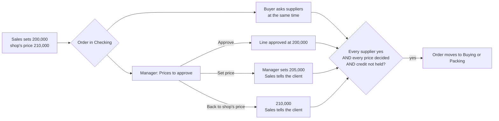

# Who decides what: decision rights for the Omni-Ware team

**Status: binding.** Agreed with the owner on 18 Oct 2026, revised the same
day, and completed with the owner's answers on the open questions (trips,
restock, trip cash, sourcing intake, supplier confirmations, delivery
directions, push, and where the owner works). This file is the authority on who may decide what in every
Omni-Ware app and in every migration that writes `role_tasks`. The apps are
index.html, sales.html, buyer.html, store.html, manager.html, accounts.html,
and the Sourcing app.

If code, a comment, a migration header or a line of UI text says "the owner"
for a decision this file gives to a role, **this file wins**. Correct the
other place in the same change. `test/decision-rights.test.js` holds the table
below against the migrations, so the two cannot drift apart silently.

---

## 1. The principle: the owner watches the machine, and is not part of it

> **Nothing in the day-to-day running of the shop waits for the owner.**
> Every operational decision belongs to a role. The owner reviews, watches
> and sets policy. The owner can step in on anything, but no order, payment
> or job may ever sit waiting for an owner who may not reply.

| | Role | Job |
|---|---|---|
| 1 | **Owner** | Hires, sets policy numbers, and watches. **Gets a log, never a queue.** Keeps only the governance listed in section 4. |
| 2 | **Manager** | Runs the team on the ground. Decides prices (anything at or above cost) and markups. Decides credit and invoicing, returns, voids and credit notes, short picks and stock write-offs. Edits customers, watches debtors, and sets each salesperson's goal. |
| 3 | **Accounts** | The treasurer, chosen by the owner with trust. Runs **everything finance**: payments in and out, expenses and other income, transfers, payroll and rent, loans and assets, supplier and agent payments, and the daily close. Sees every financial figure and report. |
| 4 | **Sourcing** | Finds new items and new suppliers and negotiates. Keeps the supplier price list right, confirming the share of prices the owner sets for each day. |
| 5 | **Sales, Buyer, Store** | Do the work and propose exceptions. Nobody decides their own exception. |

### Where each kind of work lives

- **Actions live in the phone apps.** Every operational action has a home in
  the role's phone app. That includes everything that today can only be done on
  the desktop console.
- **The Owner app** holds only what needs the owner: hiring, roles and task
  switches, the policy numbers, the log of every decision, stepping in, and the
  governance in section 4.
- **The desktop console becomes the intelligence centre**: analytics, the AI
  manager, forecasts and reports. It informs and advises, and it is not where
  the day's work is done. Until each action exists in a phone app, the console
  keeps it working. Once the phone app has it, the console's copy is retired.

Three rules hold for every role:

- **Nobody sells below cost** in a role app. Cost is the only price floor.
- **Every decision a role makes for the owner is logged**: who, when, and what
  it was before. The owner sees it without approving it.
- **A day-to-day job with no row in section 2 is a gap, not the owner's.** Ask
  the owner which role takes it; never default it to the owner.

The old wording, "stays the owner's" (migrations 0083, 0113 to 0117),
described the first build, not the policy. Where it covers a row in section
2, it is out of date.

---

## 2. The decision table

`Who decides` lists the roles that hold the task. The owner and admins hold every
task through `has_task()` (0113) and are not listed: they *can*, but are never
*needed*. `Built` says which of those roles a migration grants the task to
today:

- **yes**: every role listed holds it
- **no**: none holds it yet (it is planned, see section 5)
- **yes: Buyer**: only the roles named hold it so far

A session that builds a row grants the task in a migration and updates the
row in the same commit. The test fails on any mismatch, in either direction.

### Selling and pricing

| Decision | Task | Who decides | Proposes | Told | Built |
|---|---|---|---|---|---|
| Make an order at or above the shop's price | `quote.make` | Sales | — | — | yes |
| **Sell over the counter: pay and go, for goods on the shelf** | `counter.sell` | Sales | — | Manager | yes |
| **Forward an item we don't sell to Sourcing, while taking the order** | `sourcing.ask` | Sales | — | Sourcing | yes |
| **Sell below the shop's price (at or above cost)** | `price.approve` | Manager | Sales | Sales, owner's log | yes |
| **Price a line that has no selling price or no known cost** | `price.approve` | Manager | Sales, Buyer | Sales, owner's log | yes |
| **Change a product's markups or the shop's default markup** | `markup.set` | Manager | Manager | owner's log | yes |
| **See costs and margins** | `margin.see` | Manager | — | — | yes |
| Take a supplier's new price on an order line | `line.reprice` | Buyer | — | Manager (margin) | yes |
| Move an order along the board | `order.move` | Sales, Manager | — | — | yes |
| Add a customer (Sales); **edit any customer's details (Manager)** | `customer.edit` | Sales, Manager | — | — | yes |
| Reply in WhatsApp chats | `msg.reply` | Sales | — | — | yes |

### Invoicing, returns and voids

| Decision | Task | Who decides | Proposes | Told | Built |
|---|---|---|---|---|---|
| **Invoice a delivered order** (the nightly job invoices the rest, see section 3) | `invoice.make` | Manager | — | Accounts, Sales | yes |
| **Settle a short pick: bill what went, or the full quantity** | `pick.settle` | Manager | Store | Sales | yes |
| **Accept a customer return, raise a credit note** | `credit_note.raise` | Manager | Sales, Accounts, Store | Accounts, owner's log | yes |
| **Void an invoice** | `invoice.void` | Manager | Sales, Accounts | Accounts, owner's log | yes |
| Send an invoice | `invoice.send` | Accounts | — | — | yes |

### Credit, debtors and agents

| Decision | Task | Who decides | Proposes | Told | Built |
|---|---|---|---|---|---|
| Release an order held for credit | `credit.release` | Manager | Sales | Sales | yes |
| **Set a customer's credit limit, payment terms, and the shop's hold days** | `credit.set` | Manager | Sales, Accounts | owner's log | yes |
| **Record a customer's promise to pay** | `promise.record` | Sales, Manager, Accounts | — | Manager | yes |
| **Give a customer an opening balance: what they owed before these books, once confirmed with them** (`set_opening_balance`, 0148; only before they trade) | `debt.open` | Manager | — | owner's log | yes |
| **Decide an agent's change or cancel request** | `agent.change` | Manager | the agent | Buyer, the agent | yes |
| Take a customer's payment | `payment.receive` | Sales, Manager, Accounts | — | — | yes |
| &nbsp;&nbsp;…as one write (`receive_payment`, 0139): the money spread oldest first or over the bills ticked, a receipt per bill, the bill's payments and share of the debt, the debt lowered and logged, the rest on account; nothing lands part-way | | | | | yes |
| Send a statement | `statement.send` | Sales, Manager, Accounts | — | — | yes |

### Money: the treasurer

| Decision | Task | Who decides | Proposes | Told | Built |
|---|---|---|---|---|---|
| Count each account at close | `day.count` | Accounts | — | — | yes |
| Close a day that agrees | `day.close` | Accounts | — | owner's log | yes |
| Book an untraced shortage or overage | `variance.book` | Accounts | — | owner's log | yes |
| Pay a supplier's bill | `bill.pay` | Accounts | — | owner's log | yes |
| **Set an opening balance; reopen a closed day** | `day.open` | Accounts | — | owner's log | yes |
| **Record an expense: rent, fuel, transport, utilities, anything paid out** | `cash.expense` | Accounts | — | owner's log | yes |
| **Record other income: a loan received, owner investment, other** | `cash.income` | Accounts | — | owner's log | yes |
| **Move money between Cash, Mobile Money and Bank** | `cash.transfer` | Accounts | — | owner's log | yes |
| **Correct a recorded payment, or move it to the right invoice** | `payment.edit` | Accounts | Sales, Manager | owner's log | yes |
| **Record a supplier's paper bill or a supplier credit** | `bill.record` | Accounts | Buyer | owner's log | yes |
| **Settle with a consignor** | `consign.settle` | Accounts | — | owner's log | yes |
| **Run payroll and rent: dues, days worked, absences, paying them** | `payroll.run` | Accounts | Manager (days) | owner's log | yes |
| **Record and repay loans** | `loan.edit` | Accounts | — | owner's log | yes |
| **Record assets, and their sale or disposal** | `asset.edit` | Accounts | — | owner's log | yes |
| **Pay agents: commission claims, cash an agent brings in** | `agent.pay` | Accounts | — | the agent, owner's log | yes |
| **Count a buying trip's cash back against the cash given; pay the Buyer back for stops paid on their own money (`buyer_payback`, 0154); take back cash handed over that no round used (`buyer_cash_back`, 0154)** | `trip.cash` | Accounts | Buyer | Manager, owner's log | yes |
| **See every financial figure: P&L, balance sheet, cash flow, debtors, creditors** | `finance.see` | Accounts | — | — | yes |

### Stock and the yard

| Decision | Task | Who decides | Proposes | Told | Built |
|---|---|---|---|---|---|
| Count a trip off the truck at the yard | `trip.checkin` | Store | — | — | yes |
| **Put a trip's goods on the shelf, from the yard's count** | `stock.receive` | Store | Buyer | Manager when it differs | yes |
| **Accept a difference between the buyer's and the yard's count** | `trip.difference` | Manager | Store | Buyer | yes |
| Count the shelf (blind stock take) | `stock.count` | Store | — | Manager | yes |
| Accept a stock take, which corrects the stock | `stock.correct` | Manager | Store | owner's log | yes |
| **Report damaged, lost or stolen stock** | `stock.report` | Store | — | Manager | yes |
| **Write off damaged, lost or stolen stock** | `stock.writeoff` | Manager | Store | owner's log | yes |
| Pick and pack an order | `order.pick` | Store | — | — | yes |
| Load the truck, choose the driver | `order.load` | Store | — | — | yes |
| Deliver, with proof | `order.deliver` | Store | — | — | yes |
| Lock a road route to a place; **name the delivery directions on the load map** | `route.lock` | Store | — | — | yes |

### Buying

| Decision | Task | Who decides | Proposes | Told | Built |
|---|---|---|---|---|---|
| Record a supplier's yes or out on an order | `supplier.confirm` | Buyer | — | Sales | yes |
| Switch a line to another supplier or our shelf, **or to another item (make or size)** | `line.switch` | Buyer | — | Sales | yes |
| Drop a line nobody has | `line.drop` | Buyer | — | Sales | yes |
| Plan a buying trip, with the cash for it | `trip.plan` | Buyer | — | — | yes |
| Ride a trip and hand it in (**Store staff may ride one too**) | `trip.collect` | Buyer, Store | — | Store | yes |
| **Buy to refill the shelf when no order needs it (what to buy)** | `buy.restock` | Buyer | — | Manager | yes |
| **Hold a restock line ("not yet")** | `restock.hold` | Manager | — | Buyer | yes |

### Sourcing

| Decision | Task | Who decides | Proposes | Told | Built |
|---|---|---|---|---|---|
| **Work a request: asked, looking, found, priced, listed** | `sourcing.lead` | Sourcing | Sales | Sales (who asked) | yes |
| **Act on searches that found nothing: hunt them, set the words aside, or teach a name to an item we sell** (`search_misses`, `search_mutes`, `item_names`, 0146) | `sourcing.lead`, `product.edit` (a name) | Sourcing | Sales, agents, the website (by searching) | owner's log | yes |
| **Add a new item to what we sell, or edit a product's details (not its markup)** | `product.edit` | Sourcing | — | Manager (to set the markup) | yes |
| **Add or edit suppliers, and merge two records that are one supplier** (`merge_suppliers`, 0145) | `supplier.edit` | Sourcing | Buyer | — | yes |
| **Keep the supplier price list and rival prices right** | `price.list` | Sourcing | Buyer | — | yes |
| **Say two items are one item (or not), and put an item in its right aisle** (`item_twins`, 0152; the Buyer flags pairs as a sourcing_fix) | `product.edit` | Sourcing | Buyer | owner's log | yes |
| **Confirm today's share of prices, and set how many a day** (`set_prices_per_day`, 0145; the owner can still change it); the Buyer confirms by phone for a supplier who is slow or can't | `price.confirm` | Sourcing, Buyer | — | owner's log | yes: Sourcing, Buyer |

### The team

| Decision | Task | Who decides | Proposes | Told | Built |
|---|---|---|---|---|---|
| **Set each salesperson's goal** | `goal.set` | Manager | — | the salesperson, owner's log | yes |
| **Set how long an order may sit in each stage** | `team.limits` | Manager | — | — | yes |
| Hand a job to another person | `order.assign` | Manager | — | both people | yes |
| Nudge someone | `team.nudge` | Manager | — | the person | yes |

---

## 3. How the key flows must work

### Invoicing: the Manager, or automatic after 24 hours

- The **Manager** invoices delivered orders from the Manager app.
- **Automatically**, 24 hours after `deliveredAt`, every delivered order that is
  still not invoiced gets invoiced by a server job. This must not depend on
  anybody having an app open.
- The job skips an order only when something is still undecided: an unsettled
  short pick, or a price waiting for a decision. That order goes to the
  Manager's Needs a yes. It never waits for the owner.
- Invoicing does three things at once:
  - takes the stock off the shelf, oldest lots first;
  - raises the customer's debt;
  - creates one bill per supplier.

  It lives in **one** database function, `invoice_order(shop, order)` (0119),
  used by the Manager's button, a salesperson's counter sale and the hourly
  run (`ow_invoice_due_orders`, on pg_cron). Never write a second copy in
  JavaScript. The console's Invoice button calls the same function (it
  saves the order first, then reads the shop back), so an order is never
  invoiced twice; the console invoices for itself only on a database
  without 0119. Taking an invoice back stays in the console: the server
  leaves on the order what that needs, and a copy that never saw the
  server's invoice cannot take it back.

### The price decision

```
  below cost      │  cost ──────────── Manager decides ──────────── shop's price  │  above the shop's price
  refused, always │  Sales proposes, the order waits in Checking for the Manager  │  Sales decides, no wait
```

- **The shop's price** is cost plus the product's markup (`products.*_markup_*`,
  else `presets.defaultMarkup`). It is what sales.html calls `shopSellPrice`.
- **Cost** is what sales.html calls `lineCost`.



1. **Sales** sets a price below the shop's price. The line is tagged
   `priceNote: 'under'`, `priceBy`, `priceShop`, `priceAt` (already written
   today). The tag reads **"waiting for <Manager's name>"**.
2. **The Buyer** checks suppliers in parallel. No time is lost.
3. **The Manager** sees the line in **Prices to approve**, on Needs a yes beside
   the credit holds. They see it as a ladder: cost, the salesperson's price, the
   shop's price, and what this customer usually pays, each with its margin.
   Three actions:
   - **Approve**
   - **Set price**: any figure at or above cost
   - **Back to the shop's price**
4. **Sales** gets "Tell them" on Today when the Manager's price differs from
   what the client was told.
5. **The order leaves Checking** only when every supplier has said yes, every
   price that needed a decision has one, and the credit check is not holding it.
   Whoever clears the last gate moves the order.
6. A decision **goes stale** if the price or quantity changes afterwards.

The same gate covers `nomargin` and `nocost` lines. A `nocost` line waits for
the Buyer's cost first.

**Data.** The decision is kept on the order line, in `saved_quotes.payload.items[]`:

```
priceReview: { state: 'approved' | 'changed', price, was, by, byName, at }
```

**Enforced in the database.** A guard on `saved_quotes` has two rules:

- only `has_task('price.approve')` may write `priceReview`;
- an order cannot leave `draft` while a price waits, or while `creditCheck`
  holds it.

The same rule is enforced in every app that can move an order out of Checking.

### Orders that need nothing from a supplier

An order filled entirely from our own shelf **skips Checking** and goes straight
to Packing. It stops in Checking only when the Manager has a price or credit
decision to make on it.

A **counter sale** at or above the shop's price is sold, paid and invoiced in
one slide, and in **one database write** (`counter_sale`, 0136): the money, the
order and the invoice land together or not at all, so a phone that loses
signal half-way leaves no ghost order and no unmatched cash. A counter sale
below the shop's price needs the Manager's yes first, by push to the Manager's
phone; the same function places it and waits.

### Goods from a trip onto the shelf

The Store's yard count (`yardQty`) is what puts the goods on the shelf, and it
moves the orders on from Buying to Packing. If the yard's count differs from
the Buyer's, the shelf takes the yard's count. The Manager sees the
difference and accepts it (`trip.difference`). The Buyer's prices paid update
the supplier price list automatically.

### Sourcing and prices

- **Sales** forwards an item we don't sell while taking the order: what the
  customer asked for, how many, and who asked.
- It lands in the **Sourcing** app as a request. Sourcing takes it through
  asked, looking, found, priced and listed.
- Listing it creates the product. The Manager sets its markup.
- Everyone who asked is told.
- **A line dropped at Checking** because nobody has it becomes a Sourcing
  request by itself, with the customer who asked.
- **A line the client waits for** (the Buyer's "client waits", also how the
  Buyer asks Sourcing to find a supplier for a line nobody sells) becomes a
  Sourcing request the same way (0139). When Sourcing finds a supplier, the
  Buyer who sent it gets a push (0144).
- Agents' stock requests (`agent_requests`, kind `stock`) land there too.
- Each day, **Sourcing confirms its set number of supplier prices**
  (`presets.priceReview`, set in the Sourcing app since 0145), oldest first:
  still right, or the new figure.
- **The Buyer confirms on a supplier's behalf** by phone when the supplier is
  slow or can't do it themselves. It counts toward the day's share, as does a
  price paid on a trip (`price_source` 'confirmed' and 'purchase', 0136).
- **Later, suppliers confirm their own prices and items** in a supplier app.
  Like agents, suppliers are outside the shop and not a shop role. Their
  confirmations go through server functions, the way agent orders do. Until
  that app exists, Sourcing and the Buyer cover it.

### What is on the shelf to sell

Stock leaves the books when the order is invoiced (`ow_invoice_core`), which
can be a day after delivery, or later while a price or a short pick waits.
Until then the goods are gone from the shelf but still counted on it. So every
app shows what is **available**: the shelf less what the invoices of live
orders will take (each line from the shelf, or bought in and received, on an
order past Checking that is not invoiced, voided or cancelled), never below
zero (`shelfAvailable`, `heldForOrders` in Sales, Store and Buyer). Nothing
moves at delivery; the invoice still takes the stock, once.

### Cash for a buying trip

The Buyer plans a trip with the cash for it (`trip.plan`). When the trip is
handed in, **Accounts** counts the cash that came back against the cash given
and what was paid at each stop (`trip.cash`). Any difference is booked the way a
close difference is, and the Manager is told.

The count is one write (`trip_cash_count`, 0138): what was paid at each stop
becomes a Stock Purchase line in the cash book, the orders' supplier bills are
marked paid by the trip (a bill the invoice raises later is born paid, and
names the trip), the difference is the short or over line, and the owner's
log gets the line. The cash given and brought back are not lines of their
own: the book moves by what stayed at the suppliers.

When the Buyer pays a round from their own pocket, the round's stops say so
(`collection_trips.pay`, the Buyer's 0151) and are never in a count. The
hand-in passes Accounts an `own_money` hand-off, and **Accounts** pays the
Buyer back (`trip.cash`) in one write (`buyer_payback`, 0154): a Stock
Purchase line per stop from the account picked, the orders' bills marked paid
by the trip, the hand-off closed and the owner's log line. Cash handed over
that no round used (a `trip_cash` hand-off with `v` 2 and no `round`) is
counted back the same way as a trip's (`buyer_cash_back`, 0154). A stop with
no receipt has no paper bill to record; its amount stands.

### Push notifications are part of the system

Every handoff in this file that waits for someone **sends that person a push**.
That covers:

- a price to approve, a credit hold, a short pick, a trip difference, a
  write-off report, an agent's request, and the counter-sale yes, all to the
  Manager;
- a trip back, to the Store and to Accounts for the trip's cash;
- a price changed, to Sales ("tell them");
- a request listed, to the salesperson who asked;
- the owner's log, as a daily digest, not a ping per decision, at the hour
  the owner picks in the Owner app (`presets.digestHour`, 19:00 when unset;
  0127 runs `ow_owner_digest` every hour and sends each shop at its own).

0131 adds the handoffs the notifications canvas found telling nobody: an
invoice to void or credit (Manager), credit released and a void ask decided
(the salesperson), an order to buy and cash ready for a trip (Buyer), a
report decided (Store), a trip that needs cash and a bill due tomorrow
(Accounts), and a new request, a line dropped at Checking and the day's
prices to confirm (Sourcing).

0136 adds a line dropped at Checking, to the salesperson who took the order
(`line.dropped`), and the Manager's hold and release of a restock line, to
the Buyer (`restock.held`, `restock.released`, on `restock_buys`).

0138 adds the invoice itself (`order.invoiced`): to Accounts to send it
(`invoice.send`) and to the salesperson who took the order, with what is due
or that it is paid. A price change (`price.changed`) now goes to the
salesperson only when the price their line carries has moved.

0134 adds the other four things the Buyer passes on (`buyer_handoffs`): a
paper bill to record (Accounts, `bill.record`), a supplier's details to fix
(Sourcing, `price.list`), an item switched (the salesperson on the order, else
Sales by `quote.make`) and why the trip's count differs (the Manager,
`trip.difference`).

A tap on a push opens the screen it is about: each app's `pushOpen` reads the
push's kind and the ids it carries (push-send copies the ref into the data).

Built in 0120: the database writes each of these to `push_outbox` in the
same transaction as the handoff, addressed by task (so it follows this file),
and `push-send` delivers it. A new handoff adds its trigger there, never a
send from an app.

Every phone app ships with push, the Owner app (`com.omniware.owner`) included. A nudge is a push,
no longer only a WhatsApp link.

### Settings stored as one block

`app_settings` presets such as `defaultMarkup`, `creditHold`, stage limits
and `priceReview` are written through narrow functions that check `has_task`.
Never open the whole settings row to a role. The same goes for product markups:
a guard on `products` lets `markup.set` change only the markup columns, and
lets `product.edit` change only everything else.

The owner's own keys go the same way, through `owner_set_preset` (0127):
`priceReview.perDay`, `digestHour`, the receipt details and the word lists, one
key at a time. The console still saves the whole row from its own copy, so
0127's `app_settings_keep_role_keys` keeps `digestHour`, `creditHold` and
`priceReview.perDay` when a console save leaves them out.

---

## 4. What the owner keeps: governance, never operations

- Hiring: staff records, pay rates, roles, and switching on each role's tasks
- The policy numbers: the shop's own goal (how many prices Sourcing confirms
  per day moved to Sourcing, 0145; the owner can still change it)
- One-time shop set-up: receipt details, MoMo merchant set-up, the words and
  categories
- Restoring a backup, clearing data, and every permanent delete (0058).
  Day-to-day corrections are voids, reversals and credit notes, which the
  roles above make.

Where it lives: the **Owner phone app** holds these and the log of every
decision made on the owner's behalf. The **desktop console** is the
intelligence centre for analytics, the AI manager and reports (section 1).

Built in 0127 and `owner.html`:

- **Switching a role's tasks.** `role_tasks` stays the list of what each role
  *can* be given. The owner switches a task off for their shop
  (`shop_task_off`, through `owner_set_task`), and `has_task()` honours it, so
  every guard and function refuses a switched-off task, and a push addressed by
  that task no longer reaches the role. Switching it back on deletes the row.
- **Stepping in.** `owner_step_in` puts a logged decision back, or sets another
  value, through the role's own function (the Manager's, from 0122), so the
  role's guards and log apply, and the new log line carries `steps_in`, the
  line it answers. Other kinds of decision are refused by name, and the app offers a
  call to the person instead.
- **Hiring, pay and the shop's goal.** These are written by the app, logged as
  the owner's (`staff.hire`, `staff.edit`, `goal.shop`). The goal is a
  `manager_notes` target with no `who`, the row the Manager's app and the
  console already read.
- **Backups.** A copy of every shop table goes to the phone. Restoring,
  clearing all data and a permanent delete stay on the desk console for now,
  where the whole of the books is loaded and checked first, and the Owner app
  says so.

---

## 5. Build order

0. **The shared foundation, built once, before any app builds on it** (built:
   0119 and 0120):
   - the Checking gate (prices and credit) as a database guard
     (`saved_quotes_ow_checking_gate`). A move it refuses is kept back on the
     order (`gateHeldMove`) and made by the write that clears the last
     decision. Only `price.approve` writes a line's `priceReview`.
   - the one invoicing function, `invoice_order`, used by the Manager's
     button, the counter sale and the 24-hour run
   - the server job for the 24-hour automatic invoice (every hour, on pg_cron)
   - adding the `'sourcing'` role (done ahead of the rest, in 0128)
   - push for every app: `push_outbox`, filled by the database at each
     handoff, delivered by the `push-send` Edge Function. Each phone app
     registers its FCM token in `push_subscriptions` under its own login.
   - the console asks the same gate (`orderCheckingGate`) before a move,
     invoices through `invoice_order`, and keeps the keys the apps and the
     server write

   No app session builds its own copy of any of these.

1. **Nothing waits for the owner on an order**
   - shelf-only orders skip Checking
   - the Store's count puts goods on the shelf
   - the Manager invoices, and the 24-hour automatic invoice
   - the Manager settles short picks
   - the counter sale
2. **Price approval**, and making the credit hold real (recorded today,
   enforced nowhere).
3. **Accounts as treasurer**
   - expenses, income, transfers
   - payroll and rent, loans and assets
   - supplier bills on paper, consignment, agent payments
   - payment corrections, openings
   - the finance reports
4. **The Manager's remaining decisions**
   - markups and margins
   - credit limits and terms
   - editing a customer (granted already, no screen yet)
   - goals and stage limits
   - agent change requests
   - write-offs, with the Store's report
   - returns, voids, credit notes
5. **Sourcing** (the role itself was added ahead of step 0, in 0128)
   - the staff form and the invite link for the role
   - the Sales "we don't sell it" button
   - requests, products, suppliers, the price list, the daily confirmations
6. **Restock buying** in the Buyer app.

### Migration numbers, reserved

Several sessions build at once, so each one has its number. Use yours; never
"the next free number".

| Number | For |
|---|---|
| 0119 | The shared foundation: gate, invoicing function, 24-hour job (the `'sourcing'` role went ahead in 0128) |
| 0120 | Push for every app |
| 0121 | Sales |
| 0122 | Manager |
| 0123 | Accounts |
| 0124 | Store |
| 0125 | Buyer |
| 0126 | Sourcing |
| 0127 | Owner app |
| 0128 | The `'sourcing'` role, ahead of the rest of the shared foundation (0119) |
| 0129 | Push for 0122's tables: the write-off report and the held restock line (after 0120 and 0122) |
| 0130 | Sales, second: the counter sale's quiet push, and asking Accounts to correct a payment (`payment_asks`) |
| 0131 | Pushes for every handoff: the eleven the notifications canvas added (invoice asks, credit released, an order to buy, trip cash, a report decided, Sourcing's requests, bills due, prices to confirm) |
| 0132 | The supplier app: supplier accounts, sessions, answers and price proposals (was 0109 on its branch, which main had already used) |
| 0133 | A supplier's answer from the supplier app pushes the Buyer (`supplier.confirm`) |
| 0134 | Pushes for the Buyer's other four hand-offs (paper bill, details to fix, item switched, yard note) |
| 0135 | A new customer's id past C999: invoicing (0119) and `next_entity_id` (0032) no longer cut C1000 to C100 |
| 0136 | The audit of 19 Oct 2026, part one: the counter sale as one write (`counter_sale`), restock goods reaching the shelf (`receive_trip`), "cash first" holding until paid, phone and trip prices counting in the share, the restock hold on `restock_buys` (`hold_restock_buy`; `restock_lines` retired), a dropped line pushed to the salesperson (`line.dropped`), the invoice label past 9999 |
| 0137 | The audit, part two: the indexes the apps' date windows, the live refresh and the hourly invoice run were missing |
| 0138 | The audit, part three (one order driven through all five apps): row ids as one sequence per table (`ow_reserve_row_ids`, every table's identity sequence kept ahead), a trip's or a phone's price on the side it was bought on (`ow_price_side`), `price.changed` only when the line's price moved, a cash trip's money reaching the books (`trip_cash_count`, bills born paid by the trip), the invoice push (`order.invoiced`), and Accounts' payment guard (0123's bare array literal) |
| 0139 | The end-to-end test of 19 Oct 2026, fix 2: invoicing refuses a line still to price (`OWTPC`), never makes a debtor of a generic name like "Walk-in" (`OWWLK`), keeps a supplier bill already on the order instead of refusing it (fix 4, no more `OWBIL`), dates its bills by the supplier's terms (fix 10), and the hourly run pushes the Manager each order it skips (`invoice.held`) |
| 0140 | A customer's payment as one write (`receive_payment`, 0140): the receipts, the invoices' payments and share of the debt, the debt and its log, the rest on account, or one receipt on an order before its invoice; Sales, Manager and Accounts call it |
| 0141 | The treasurer's cash-first actions as one write each: wages and rent (`pay_dues`), a loan repaid or received (`repay_loan`, `receive_loan`), an asset bought, sold or gone (`buy_asset`, `dispose_asset`), an agent settled (`settle_agent`); each writes the cash line, the row and the owner's log line together |
| 0142 | A stock count counts delivered goods once: accepting it adds back what orders packed, out or delivered but not yet invoiced took off the shelf (`ow_held_gone`), so their invoices take it off the books once |
| 0143 | A stock count is accepted once, from 'sent' (on 0142's), and a surplus lot is valued at the last cost known (`ow_last_known_cost`); an Accounts login cannot book a cash line on a closed day (the 0123 guard on INSERT too) |
| 0144 | Buyer, second: Sourcing finding a supplier for a line the client waits for pushes the Buyer who sent it (`sourcing.found`), and a trip handed in short pushes each short order's salesperson (`trip.short`) |
| 0145 | Sourcing v2: two supplier records that are one supplier merged in one write (`merge_suppliers`, supplier.edit), and prices a day set by Sourcing (`set_prices_per_day`, price.confirm) |
| 0146 | Sourcing v2, round 5: every search that finds nothing logged by itself (`search_misses`; `log_search_miss` for Sales, the console and agents, `ow_record_search_miss` for the website), read by Sourcing (sourcing.lead), who sets words aside (`search_mutes`) or teaches a name to an item (`item_names`, product.edit); an agent's "ask the shop to stock it" pushes Sourcing (`sourcing.request`) |
| 0147 | Buyer, third: a round is handed in once, at the yard, so the Store and Accounts are told once per round (`ow_trip_round`), not once per stop |
| 0148 | A fresh start: a new shop copied from the old one's reference data, never its balances (`ow_fresh_start`), and switch day moving the team, agent logins, catalogues and WhatsApp numbers (`ow_fresh_start_move`), both the operator's in the SQL editor (docs/fresh-start.md); then the Manager confirms each customer's old balance and enters it (`set_opening_balance`, debt.open) |
| 0149 | A fresh start, choosing what stays behind: `ow_fresh_start` takes a list of groups to leave in the old shop (price list, team, settings, property); customers and suppliers always come across. The operator's, in the SQL editor |
| 0150 | Buyer, fourth: a trip's runner is told — sent or given a trip (`trip.sent`, once per round), the trip given on to someone else (`trip.taken`), or the trip cancelled by the Buyer's chase (`trip.cancelled`) |
| 0151 | Buyer, fifth: a round's own money and receipts kept on the trip (`collection_trips.pay`), the Buyer's pay-back passed to Accounts (`own_money` hand-off, pushed `trip.own_money`), Accounts' cash tied to the round it started (`payload.round`), and a carton far bigger than the sale asked of the Manager (`restock_buys.for_line`, held, pushed `carton.ask`) |
| 0152 | Sourcing v2, round 7: one item, one name — Sourcing's verdict on two items that look like one (`item_twins`, product.edit): the same item (one name kept, the other taught as a name of it, `item_names`) or different; read by every member so the Buyer sees the shelf twin before buying. Both rows stay on the books; stock is never Sourcing's. (0151 is the Buyer's.) |
| 0153 | Sales, third: a supplier's price up that puts a line under its sale pushes the Manager (`price.waits`, price.approve), and the Manager's new price on it pushes the salesperson to tell the customer (`price.decided`) |
| 0154 | Accounts and the Buyer's money (the cross-app test of 21 Oct 2026; Buyer's side is 0151): pay the Buyer back for a round on their own money (`buyer_payback`: a Stock Purchase per stop, the orders' bills paid by the trip, the hand-off closed), take back cash handed over that no round used (`buyer_cash_back`, `buyer_handoffs.cash_back`), and a bill raised after the payback born paid |

A session that needs a second migration takes the next number after 0127 and
adds it to this table in the same commit.

### Known text that now contradicts this file

These are fixed when the matching row is built:

- **buyer.html**: "Owner checks it in", "the owner pays", "The owner keeps the
  price list."
- **The headers of migrations 0113, 0116 and 0117**, where they say these stay
  the owner's. Leave applied migrations as they are. The migration that builds
  each row records the change.
