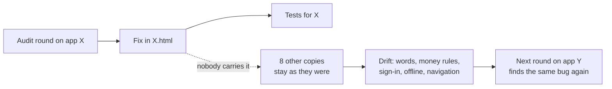
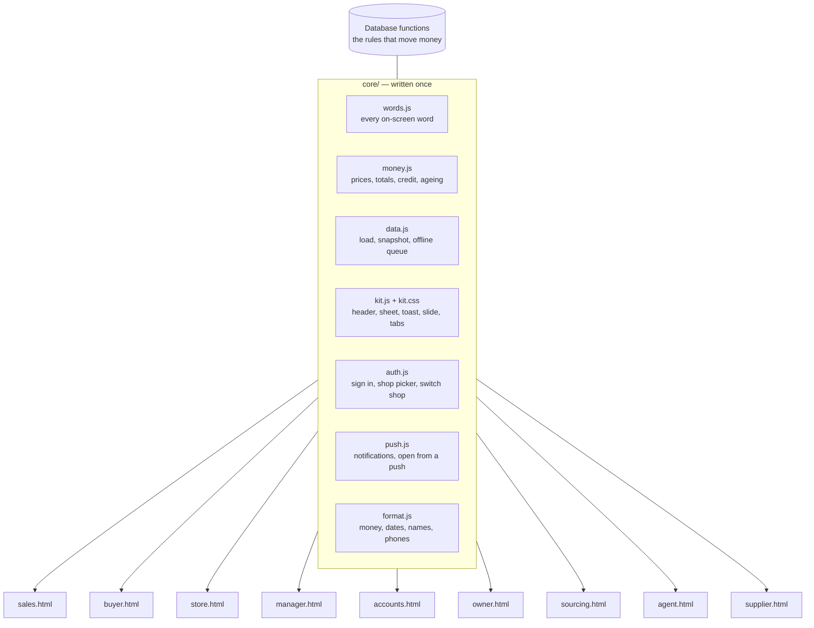
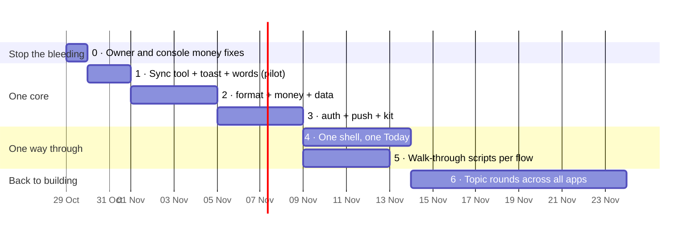

# One system, nine apps

**Status: proposal, for Kevin to approve.** Written 28 Oct 2026.

**The problem.** A fix made in one app does not reach the others. The words differ from app to app. The workflows are hard to follow, even for the developer.

**The cause.** No two apps share any code. Each app is one HTML file holding its own copy of everything.

**The fix.** Write each shared piece once. Every app gets the same copy automatically, and a test fails when any app's copy drifts.

Read with `docs/decision-rights.md` (who decides), `docs/phone-design-language.md`
(the look) and `docs/audit/GLOSSARY.md` (the words).

---

## 1. What is wrong, measured

| | Today |
|---|---|
| Role apps | 9 phone apps (`sales`, `buyer`, `store`, `manager`, `accounts`, `owner`, `sourcing`, `agent`, `supplier`), plus the desktop console (`index.html`) |
| Shared code files the apps load | **0** |
| Functions copied into 4 or more apps | **141** (about 5,700 lines, 4,500 of them extra copies) |
| …of those, now in 2 or more different versions | **85** |
| `toast` | 9 apps, **7 versions** |
| `boot` | 9 apps, **9 versions** |
| `authScreen` (sign in) | 7 apps, **7 versions** |
| `loadAll` (loading the shop) | 7 apps, **7 versions** |
| Saying "no connection" | "No connection" (Sales) · "No signal" (Store, Manager) · "Offline" (Store, Agent) |

### Fixes that never reached the other apps

These money rules were fixed in one round. Some apps still run the old copy:

| Rule | Fixed in | Still the old rule |
|---|---|---|
| An item with no price is priced at 0, **never at its cost** (Sales R1 · SAL-007) | Sales, Manager, Accounts | **Owner** (both of its two copies), **console** |
| A deposit already held is not counted as more owed (`payPlan`) | Sales, Manager, Accounts | **Owner** |
| A charge with no date goes under "no date"; it is never aged as new (`custAging`) | Sales, Manager, Accounts | **Owner** |
| The markup rule (`effectiveMarkupRule`) | 4 apps agree | **Sourcing**, **console** differ |
| Payment arguments (`owPaymentArgs`) | Sales, Buyer, Accounts, console | **Manager** differs |

This is the whole problem in one table. Every audit round fixes its own app. Then
someone has to remember to carry each fix to the eight others, and nobody can.

### Why the process makes it worse



- The audit loop runs **app by app** (Store got 10 rounds and the others none), so every lesson is learned once per app.
- Parallel sessions build different apps on different branches and collide (on 28 Oct, Sales' migration 0169 had to become 0170).
- The glossary is a document that people copy from by hand, so it drifts too. Its own last section is a table titled "Not the same across apps yet".

---

## 2. The target: one core, nine views



**What stays in each app:** only that role's own screens and jobs.
**What moves to the core:** everything every app has to get the same way.

### How the core gets into each app (no new risk on phones)

The apps must stay as single files. Vercel serves them as plain files,
the phone apps fetch only `<app>.html` for live updates, and the tests read
functions straight out of the HTML. So the core goes in as **synced blocks**,
not as a new file loaded at runtime:

```
core/money.js                       sales.html
┌──────────────────────┐            ┌─────────────────────────────────┐
│ function payPlan(){…} │──sync──▶  │ /* @core money.js v12 */         │
└──────────────────────┘            │ function payPlan(){…}            │
                                     │ /* @end money.js */              │
                                     │ …the Sales screens…              │
                                     └─────────────────────────────────┘
```

- `node tools/sync-core.js` writes every `@core` block in every app from `core/`.
- `test/core-sync.test.js` fails if any app's block differs from `core/`. "I fixed it in Sales" becomes impossible: you fix it in `core/`, run the sync, and all nine change.
- Nothing about loading, the service workers, the APK builds or the live updates changes.
- Functions move **one at a time**. A function not yet moved stays exactly where it is.

Later, once everything shared is in `core/`, the blocks can become a real shared
file loaded at runtime. That step needs the phone apps' live update to fetch
more than one file, and it is optional.

### What goes into each core file

| Core file | Functions (the copies found today) | Why it must be one copy |
|---|---|---|
| `words.js` | (new) every label, button, state and error, as `W.noSignal`, `W.tryAgain`… | One word per concept, enforced instead of hoped for |
| `format.js` | `esc` `n0` `short` `fmtUGX` `todayISO` `isoOf` `daysBetween` `dayLabel` `msOf` `hm` `minsSince` `initials` `firstWord` `nameParts` `shortName` `phoneDigits` `telUrl` `waComposeUrl` `contactPhones` `failWord` | The same figure and date look the same everywhere |
| `money.js` | `productPriceRows` `tiersForKind` `tieredUnitPrice` `purchasePriceAtQty` `purchaseSideAtQty` `sellSideFor` `effectiveMarkupRule` `effectiveStockMarkupRule` `applyRule` `quoteItemSellPrice` `goodsTotal` `chargeAmount` `chargesTotal` `cashTotal` `creditTerms` `creditCharge` `quoteTotal` `balanceDue` `custTerms` `custISO` `custBillAge` `custOpen` `custLimit` `custOpenCharges` `bandOf` `custAging` `payPlan` `owPaymentArgs` `outstandingInvoices` `invoiceLabel` `orderLineIsBoughtIn` `getStockQty` `stockKey` | A different price or balance in two apps is a money bug, not a style issue |
| `data.js` | `loadAll` `selectAll` `rowToQuote` `rowToAsk` `rowToTxn` `rowToTrip` `liveQuoteFilter` `mergeQuotes` `snapKey` `saveSnapshot` `loadSnapshot` `refreshLive` `isNetworkError` `issueRowId` `IX` `ixKey` `memo` `productById` `supplierById` `customerById` `staffById` `quoteById` `supplierName` `variantLabel` `productVariantLabel` `customerOrdersFor` `liveOrders` `createdMs` | Offline and "Someone else just did this" behave the same in every app |
| `auth.js` | `boot` `start` `authScreen` `setPasswordScreen` `hideAuth` `shopInitials` `shopStarted` `chooseShop` `shopPicker` `switchShop` `shopScoped` `myName` `myStaff` `greeting` | One sign-in, one shop picker, one "Signed in as someone else" |
| `push.js` | `pushInstalled` `phonePush` `pushOn` `pushWhy` `pushNative` `pushState` `pushOpen` | A push opens the right screen in every app |
| `kit.js` + `kit.css` | `toast` `header` `paintBar` `insets` `back` `go` `push` `pop` `openSheet` `closeSheet` `renderSheet` `navHTML` `afterRender` `ic` `avatar` `tintFor` `itemIcon` `emptyCard` `closeBtn` `slideHTML` `bindSlides` `pctRing` `buzz` `sfx` `loadPrefs` `savePrefs` `applyPrefs` and the `:root` tokens | One look, one Back, one slide, one Big text |

**Money stays in the database where it decides anything.** `invoice_order`,
`receive_payment`, `counter_sale` and the other 0119+ functions already set the
pattern. `money.js` is only what a screen *shows* before the server answers.
`test/core-money.test.js` holds it to the same cases as the SQL.

---

## 3. Words as code

`docs/audit/GLOSSARY.md` stays the document for people. `core/words.js` becomes its
code twin. It holds every word the apps share, each with the round that decided it:

```js
const W = {
  noSignal:   'No signal',            // Store R3 · REL-05
  tryAgain:   'Try again',            // Store R3
  sending:    'Sending…',             // Store R3 · REL-05
  notSentYet: 'Not sent yet',         // Store R3 · REL-05
  owes:       'Owes',                 // Sales UX audit
  notPaidYet: 'Not paid yet',         // Store R6 · WORD-03
  done:       'Done',                 // the one end-of-flow button
  // …
};
```

`test/words.test.js`:
- fails if an app types a shared word itself (e.g. `'No connection'`) instead of `W.noSignal`;
- fails if any app shows a word in the glossary's **Never** column ("Someone", "On road", "Mark delivered", "Retry"…);
- fails if `GLOSSARY.md` and `words.js` disagree.

---

## 4. One way through every app

*(Filled in from the navigation map, section 5.)*

---

## 5. The workflow map

*(Filled in from the navigation map.)*

---

## 6. How the work is done from now on

| Before | After |
|---|---|
| A round fixes one app on ten topics | A round fixes **one topic across every app** ("Round W: wording, all apps") |
| A fix lands in the app it was found in | A fix lands in `core/` when the function is shared, and the sync carries it to all nine |
| Three sessions build three apps at once | **One** session owns `core/` at a time; role apps wait for it |
| Each app has its own idea of the order of tabs | The shell in section 4 is the same for every role |
| "Can I find where to do X?" is tested by hand | Each flow in section 5 is a **walk-through script** that taps through every app at 360px and fails if a step moves or disappears |

**New screens wait** until Phase 3 is done. Building more on top of the copies
only adds more copies to fix.

---

## 7. The phases



The dates are a guide, not a promise. Each phase ends only when its check passes.

| Phase | Does | Done when |
|---|---|---|
| **0** | Carry SAL-007, the deposit fix and the no-date fix to `owner.html` and the console. Remove Owner's second `quoteItemSellPrice`. | The three rules give the same answer in every app (a test runs each copy on the same cases) |
| **1 (pilot)** | `tools/sync-core.js`, `test/core-sync.test.js`, `core/words.js` with the connection, sending and error words, and `core/kit.js` with `toast`. Sales and Store only. | Both APKs built and opened on a phone. The toast and the no-signal bar look the same in both. A word changed in `core/` changes both |
| **2** | `format.js`, `money.js`, `data.js` into all nine apps, one function per commit | `core-sync` green. The `money.js` tests agree with the SQL scenarios |
| **3** | `auth.js`, `push.js`, the rest of `kit.js` and the tokens | One sign-in, one shop picker and one sheet in all nine. Every app's `:root` comes from `kit.css` |
| **4** | The shared shell (section 4): the same tabs and the same Today pattern, role by role | You can do every task in section 5 from Today in 3 taps or fewer |
| **5** | One walk-through script per flow in section 5 (Playwright, 360px, against the staging shop) | All flows walk end to end, and a moved button fails a test |
| **6** | Topic rounds across all apps: wording, then reliability, then accessibility… | Each topic closes for all nine apps at once |

---

## 8. What does not change

- **Who decides what.** `docs/decision-rights.md` stays binding. This plan only changes where the code for it lives.
- **The database.** No migration is needed for phases 0–3.
- **The look.** `docs/phone-design-language.md`, now enforced by `kit.css` instead of copied.
- **How apps install and update.** One HTML file per app, the same APK builds, the same live updates.

---

## 9. Kevin's calls

1. Approve the plan, or change it.
2. Pause new screens until Phase 3 is done: yes or no.
3. The pilot apps for Phase 1: Sales and Store, or two others.
4. The shell in section 4: the tab names.
