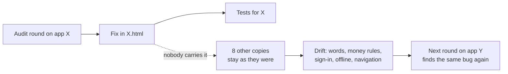
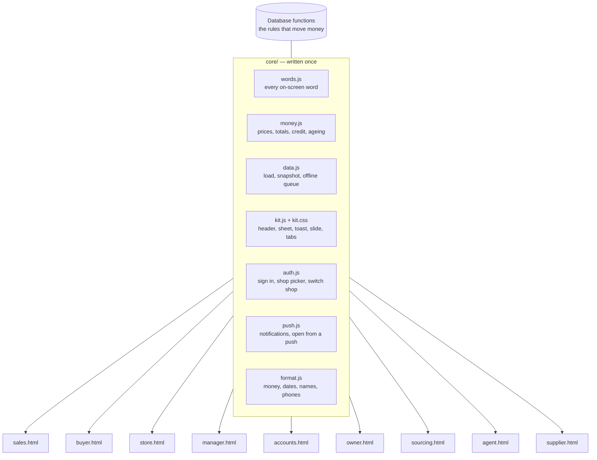
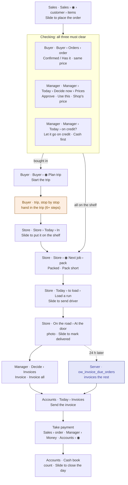
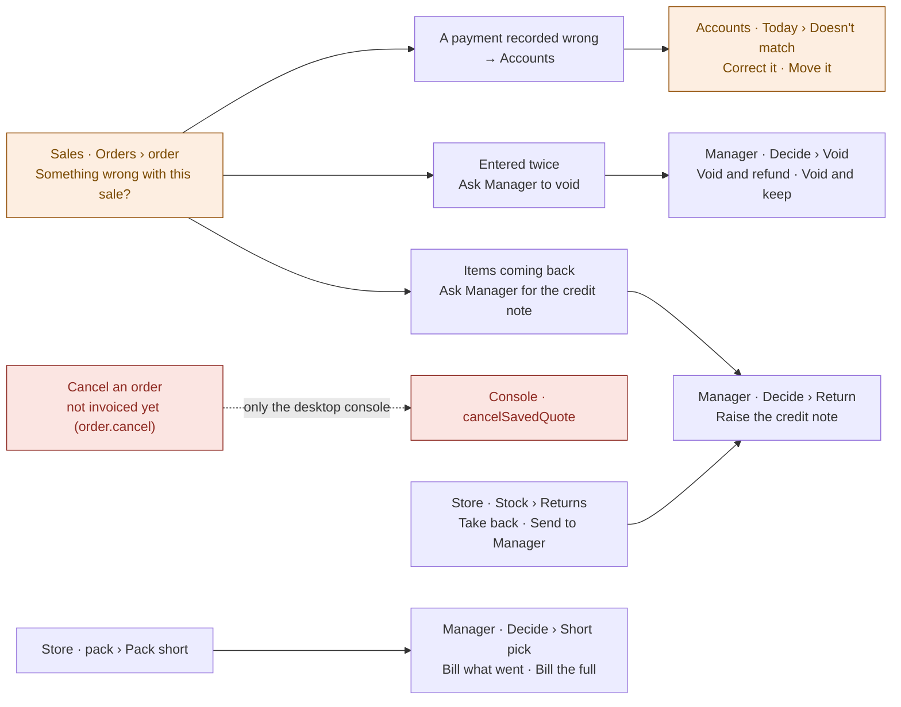
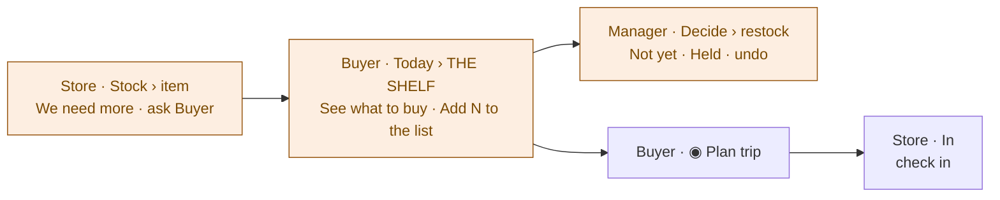
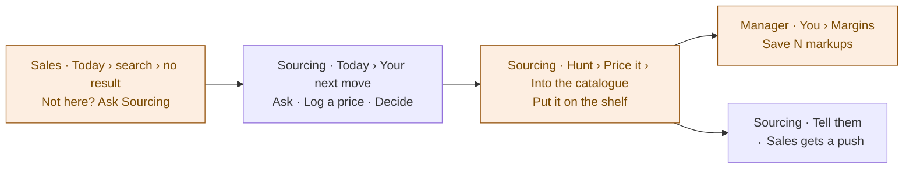
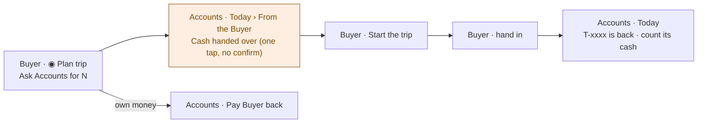

# One system, nine apps

**Status: proposal, for Kevin to approve.** Written 28 Oct 2026.

**The problem.** A fix made in one app does not reach the others. The words differ from app to app. The workflows are hard to follow, even for the developer.

**The cause.** No two apps share any code. Each app is one HTML file holding its own copy of everything.

**The fix.** Write each shared piece once. Every app gets the same copy automatically, and a test fails when any app's copy drifts.

Read with `docs/decision-rights.md` (who decides), `docs/phone-design-language.md`
(the look) and `docs/audit/GLOSSARY.md` (the words).

---

## 1. What is wrong, measured

| | Today |
|---|---|
| Role apps | 9 phone apps (`sales`, `buyer`, `store`, `manager`, `accounts`, `owner`, `sourcing`, `agent`, `supplier`), plus the desktop console (`index.html`) |
| Shared code files the apps load | **0** |
| Functions copied into 4 or more apps | **141** (about 5,700 lines, 4,500 of them extra copies) |
| …of those, now in 2 or more different versions | **85** |
| `toast` | 9 apps, **7 versions** |
| `boot` | 9 apps, **9 versions** |
| `authScreen` (sign in) | 7 apps, **7 versions** |
| `loadAll` (loading the shop) | 7 apps, **7 versions** |
| Saying "no connection" | "No connection" (Sales) · "No signal" (Store, Manager) · "Offline" (Store, Agent) |

### Fixes that never reached the other apps

These money rules were fixed in one round. Some apps still run the old copy:

| Rule | Fixed in | Still the old rule |
|---|---|---|
| An item with no price is priced at 0, **never at its cost** (Sales R1 · SAL-007) | Sales, Manager, Accounts | **Owner** (both of its two copies), **console** |
| A deposit already held is not counted as more owed (`payPlan`) | Sales, Manager, Accounts | **Owner** |
| A charge with no date goes under "no date"; it is never aged as new (`custAging`) | Sales, Manager, Accounts | **Owner** |
| The markup rule (`effectiveMarkupRule`) | 4 apps agree | **Sourcing**, **console** differ |
| Payment arguments (`owPaymentArgs`) | Sales, Buyer, Accounts, console | **Manager** differs |

This is the whole problem in one table. Every audit round fixes its own app. Then
someone has to remember to carry each fix to the eight others, and nobody can.

### Why the process makes it worse



- The audit loop runs **app by app** (Store got 10 rounds and the others none), so every lesson is learned once per app.
- Parallel sessions build different apps on different branches and collide (on 28 Oct, Sales' migration 0169 had to become 0170).
- The glossary is a document that people copy from by hand, so it drifts too. Its own last section is a table titled "Not the same across apps yet".

---

## 2. The target: one core, nine views



**What stays in each app:** only that role's own screens and jobs.
**What moves to the core:** everything every app has to get the same way.

### How the core gets into each app (no new risk on phones)

The apps must stay as single files. Vercel serves them as plain files,
the phone apps fetch only `<app>.html` for live updates, and the tests read
functions straight out of the HTML. So the core goes in as **synced blocks**,
not as a new file loaded at runtime:

```
core/money.js                       sales.html
┌──────────────────────┐            ┌─────────────────────────────────┐
│ function payPlan(){…} │──sync──▶  │ /* @core money.js v12 */         │
└──────────────────────┘            │ function payPlan(){…}            │
                                     │ /* @end money.js */              │
                                     │ …the Sales screens…              │
                                     └─────────────────────────────────┘
```

- `node tools/sync-core.js` writes every `@core` block in every app from `core/`.
- `test/core-sync.test.js` fails if any app's block differs from `core/`. "I fixed it in Sales" becomes impossible: you fix it in `core/`, run the sync, and all nine change.
- Nothing about loading, the service workers, the APK builds or the live updates changes.
- Functions move **one at a time**. A function not yet moved stays exactly where it is.

Later, once everything shared is in `core/`, the blocks can become a real shared
file loaded at runtime. That step needs the phone apps' live update to fetch
more than one file, and it is optional.

### What goes into each core file

| Core file | Functions (the copies found today) | Why it must be one copy |
|---|---|---|
| `words.js` | (new) every label, button, state and error, as `W.noSignal`, `W.tryAgain`… | One word per concept, enforced instead of hoped for |
| `format.js` | `esc` `n0` `short` `fmtUGX` `todayISO` `isoOf` `daysBetween` `dayLabel` `msOf` `hm` `minsSince` `initials` `firstWord` `nameParts` `shortName` `phoneDigits` `telUrl` `waComposeUrl` `contactPhones` `failWord` | The same figure and date look the same everywhere |
| `money.js` | `productPriceRows` `tiersForKind` `tieredUnitPrice` `purchasePriceAtQty` `purchaseSideAtQty` `sellSideFor` `effectiveMarkupRule` `effectiveStockMarkupRule` `applyRule` `quoteItemSellPrice` `goodsTotal` `chargeAmount` `chargesTotal` `cashTotal` `creditTerms` `creditCharge` `quoteTotal` `balanceDue` `custTerms` `custISO` `custBillAge` `custOpen` `custLimit` `custOpenCharges` `bandOf` `custAging` `payPlan` `owPaymentArgs` `outstandingInvoices` `invoiceLabel` `orderLineIsBoughtIn` `getStockQty` `stockKey` | A different price or balance in two apps is a money bug, not a style issue |
| `data.js` | `loadAll` `selectAll` `rowToQuote` `rowToAsk` `rowToTxn` `rowToTrip` `liveQuoteFilter` `mergeQuotes` `snapKey` `saveSnapshot` `loadSnapshot` `refreshLive` `isNetworkError` `issueRowId` `IX` `ixKey` `memo` `productById` `supplierById` `customerById` `staffById` `quoteById` `supplierName` `variantLabel` `productVariantLabel` `customerOrdersFor` `liveOrders` `createdMs` | Offline and "Someone else just did this" behave the same in every app |
| `auth.js` | `boot` `start` `authScreen` `setPasswordScreen` `hideAuth` `shopInitials` `shopStarted` `chooseShop` `shopPicker` `switchShop` `shopScoped` `myName` `myStaff` `greeting` | One sign-in, one shop picker, one "Signed in as someone else" |
| `push.js` | `pushInstalled` `phonePush` `pushOn` `pushWhy` `pushNative` `pushState` `pushOpen` | A push opens the right screen in every app |
| `kit.js` + `kit.css` | `toast` `header` `paintBar` `insets` `back` `go` `push` `pop` `openSheet` `closeSheet` `renderSheet` `navHTML` `afterRender` `ic` `avatar` `tintFor` `itemIcon` `emptyCard` `closeBtn` `slideHTML` `bindSlides` `pctRing` `buzz` `sfx` `loadPrefs` `savePrefs` `applyPrefs` and the `:root` tokens | One look, one Back, one slide, one Big text |

**Money stays in the database where it decides anything.** `invoice_order`,
`receive_payment`, `counter_sale` and the other 0119+ functions already set the
pattern. `money.js` is only what a screen *shows* before the server answers.
`test/core-money.test.js` holds it to the same cases as the SQL.

---

## 3. Words as code

`docs/audit/GLOSSARY.md` stays the document for people. `core/words.js` becomes its
code twin. It holds every word the apps share, each with the round that decided it:

```js
const W = {
  noSignal:   'No signal',            // Store R3 · REL-05
  tryAgain:   'Try again',            // Store R3
  sending:    'Sending…',             // Store R3 · REL-05
  notSentYet: 'Not sent yet',         // Store R3 · REL-05
  owes:       'Owes',                 // Sales UX audit
  notPaidYet: 'Not paid yet',         // Store R6 · WORD-03
  done:       'Done',                 // the one end-of-flow button
  // …
};
```

`test/words.test.js`:
- fails if an app types a shared word itself (e.g. `'No connection'`) instead of `W.noSignal`;
- fails if any app shows a word in the glossary's **Never** column ("Someone", "On road", "Mark delivered", "Retry"…);
- fails if `GLOSSARY.md` and `words.js` disagree.

---

## 4. One way through every app

### Today: nine apps, nine shapes

The mapping on 28 Oct read every app's tab bar. ◉ is the centre button. Every
centre button but Manager's carries **no word**, only an icon.

| App | Tab bar, left to right | The centre button does | "You" lives |
|---|---|---|---|
| Sales | Today · Chats · ◉ · Orders · Customers | Take an order | behind the face on Today |
| Buyer | Today · Orders · ◉ · Replies · Suppliers | Plan a trip (a truck) | behind the face |
| Store | Today · ◉ · Stock | Start the next job (▶) | behind the face |
| Manager | Today · Team · ◉ Nudge · Orders · Money | Nudge someone | behind the face |
| Accounts | Today · Owed · ◉ · Bills · Cash book | Money in, out, move | behind the face |
| Sourcing | Today · Pipeline · ◉ · Prices · Suppliers | Capture | behind the face |
| Owner | Today · ◉ (the log, no label) · Team & rules | Open the log | inside Team & rules |
| Agent | Today · ◉ · Clients | New order | a sheet from the face |
| Supplier | Today · Prices · Money | (none) | a sheet from the face |

Three apps have three tabs; six have five. The centre button means "start
something" in five apps, "go somewhere" in two and "push a person" in one.
"Cash book" opens a page titled "Close the day". "Pipeline" is also called "The
hunts". "Orders" in Buyer opens a page titled "Checking".

### The shell: the same rules in every role

Names may differ by role. **The rules do not:**

1. **Today first, always.** Every job waiting on this person, the most urgent on top, one button each.
2. **The centre button starts this role's main job, with its word under it** ("Sell", "Plan trip", "Next job", "Money", "Capture", "Order").
3. **Every task the role holds has a permanent home in a tab.** No task can be reached only from Today, from a push, or when something happens to be waiting. (Today breaks this for Manager's restock hold, Buyer's "What to buy", the Store's close and Accounts' corrections.)
4. **No icon-only buttons** for an action: the word sits under or beside the icon.
5. **One name per action in every app** (the table below), held by `words.js`.
6. **One end button: "Done"**, which returns to Today. Store now ends with "Done", "Back to Today" or "Later · back to Today" depending on the flow.
7. **You is the last tab**: name, shop, Big text, notifications, sign out. It never hides work. Manager's markups live only in You → Margins today.

Proposed bars (for Kevin to approve or rename):

| App | Today | Tab 2 | ◉ centre | Tab 4 | You |
|---|---|---|---|---|---|
| Sales | Today | Chats | **Sell** | Orders · Customers ⁽¹⁾ | You |
| Buyer | Today | Orders | **Plan trip** | Suppliers | You |
| Store | Today | Stock | **Next job** | Yard (In · Pack · Load · Road) | You |
| Manager | Today | Decide ⁽²⁾ | **Nudge** | Money · Team ⁽¹⁾ | You |
| Accounts | Today | Owed | **Money** | Bills · Close ⁽¹⁾ | You |
| Sourcing | Today | Hunts | **Capture** | Prices · Suppliers ⁽¹⁾ | You |
| Owner | Today | Log | — | Team & rules | You |
| Agent | Today | Clients | **Order** | Money | You |
| Supplier | Today | Orders ⁽³⁾ | — | Prices · Money ⁽¹⁾ | You |

⁽¹⁾ Two tabs where a role has two daily lists, so six tabs at most.
⁽²⁾ Decide becomes a tab, always there, with zeros when nothing waits. Today it appears only when something waits.
⁽³⁾ The Supplier app gets a list of orders: today it opens only the first one even when "3 orders wait for you".

### One name per action

| Action (task) | Says now, by app | Should say everywhere |
|---|---|---|
| Record money a customer paid (`payment.receive`) | Sales: Take payment · Collect · Take N. Manager: Take a payment · Record N. Accounts: A customer pays · Record a payment | **Take payment** |
| A promise to pay (`promise.record`) | Sales: Promise · Save the promise. Manager: Record a promise · Keep the promise. Accounts: a flag icon · Keep the promise | **Promise to pay** · Save |
| Give a job to someone (`order.assign`) | Manager: Give it to X · Assign · Assign it · Hand it to X | **Give to X** |
| Put another item on the line (`line.switch`) | Buyer: Switch item · Different item · Other item | **Switch item** |
| Take a line off (`line.drop`) | Buyer: Remove line · Remove from order | **Remove line** |
| Let an order go on credit (`credit.release`) | Manager: Let it go on credit · Release | **Let it go on credit** |
| Count the shelf (`stock.count`) | Store: Count · Count it now · Count it | **Count** |
| Report a loss (`stock.report`) | Store: Report a loss · Report damaged, lost or stolen | **Report a loss** |
| A supplier's price still right (`price.confirm`) | Buyer: Still N. Sourcing: Same · Got it · New figure. Supplier: Still the same | **Same price** · **New price** |
| Money a customer owes | Owes · To collect · TO COLLECT · Still owing · Owes the shop · Outstanding balance · Left to pay | **Owes** (one customer), **Owe** (the list), **To collect** (the total) |
| No signal | No connection · No signal · Offline · You're offline · No data right now | **No signal** · **Saved on this phone** |
| The end of a flow | Done · Back to Today · Later · back to Today · Done for today | **Done** |
| A screen that failed to draw | This screen could not be drawn · This page could not be drawn · Something went wrong | one sentence in `words.js` |

---

## 5. The workflow map

Each box is **who · app › where › the button**. Red boxes are steps no phone app
can do today, or that no button reaches. Amber boxes work but are hidden or deep
(4 or more taps, an icon with no word, or only reachable when something waits).
✔ marks findings checked by hand in the code. The rest come from the 28 Oct
mapping of the nine files and should be checked before they are fixed.

### A · An order, from the customer to the cash



| Step | Problem today |
|---|---|
| Sales sets a price under the shop's | The only way in is tapping the price on a line, which doesn't look like a button |
| Buyer confirms | One answer has two names: "Confirmed" on the slider, "Has it · same price" on the Ask page |
| Buyer reprices a line | Tap the "@ price" figure, which isn't labelled as a button |
| Store names a road on the load map (`route.lock`) | ✔ **No button opens it.** The "Name this way" sheet and its save exist, but nothing calls `ACT.ldname` |
| Take payment | Five ways in, three names (section 4) |

### B · Something wrong after the sale



| Step | Problem today |
|---|---|
| Cancel before invoicing (`order.cancel`) | ✔ **No phone app can do it.** Sales shows "Something wrong" only once `q.invoiced`. Manager's only path is the "Taken twice?" page. Only the console cancels. `decision-rights.md` marks it Built: no |
| Sales' "Something wrong" | 5 or more taps; only on invoiced orders |
| Accounts' corrections | Only on Today's "Doesn't match" list, which shows 5. "+ N more on the Cash book" points to a page that doesn't list them |

### C · The shelf runs low



| Step | Problem today |
|---|---|
| Store asks | Only on an item already low or due |
| Buyer's "What to buy" | No permanent home: shown on Today only when a shelf item is tight, or from a push |
| Manager's hold | Only inside Decide, which appears only when something waits |

### D · An item the shop doesn't sell



| Step | Problem today |
|---|---|
| Sales asks | 4 or more taps through search, or You → Asked of Sourcing |
| Sourcing lists an item | 4 or more taps; editing an item is an icon with no word |
| Manager sets the markup | Hidden in You → Margins |
| Pipeline | Its tab says "Pipeline"; other screens say "The hunts" |

### E · Cash for a buying trip



| Step | Problem today |
|---|---|
| Accounts hands over cash | **Writes on one tap with no confirm.** Every other money write is a slide |
| The trip's cash, counted | One task, four labels: Count · Pay back · Cash handed over · no round used |

### F · Agents and suppliers, outside the shop

| Flow | Path | Problem today |
|---|---|---|
| An agent's order | Agent › ◉ › Who's this for? › items › Slide to send → Sales/Store as any order | Works |
| An agent's change or cancel | Agent › order › Change / or cancel → Manager › Decide › Agent asks | Works; 4–5 taps |
| An agent's commission | Agent › Your money › Claim → Accounts › ◉ › Pay an agent | Works |
| Pause, retire or set an agent's share | **Only in the console** | No phone app writes `agents`, and **no role holds this job** in `decision-rights.md`. That is a gap Kevin must give a role |
| A supplier answers an order | Supplier › Today › Answer › Swipe to send | **Only the first waiting order opens.** No list of orders |
| A supplier's daily price check | Supplier › Today › Check (only when no order waits) or Prices | Works |

### Every gap, in one list

| # | Gap | Where | Checked |
|---|---|---|---|
| 1 | Cancel an order before it is invoiced | no phone app; console only | ✔ |
| 2 | Name a road on the load map | Store: the sheet is built, no button opens it | ✔ |
| 3 | Start a new chat | Sales: the sheet is built, no button opens it | ✔ |
| 4 | Send a statement | Manager holds the task; no button | ✔ |
| 5 | A supplier's other waiting orders | Supplier: only the first opens | map |
| 6 | Accounts' corrections past the first 5 | the Cash book doesn't list them | map |
| 7 | Cash handed over without a confirm | Accounts | map |
| 8 | Agent administration has no role | console only; needs Kevin's call | map |
| 9 | Clearance (dead-stock) pricing | console only | map, medium confidence |
| 10 | Stepping in on anything but markups and three settings | Owner says "not built yet" | map |
| 11 | Three money rules not carried to Owner and the console | section 1 | ✔ |

---

## 6. How the work is done from now on

| Before | After |
|---|---|
| A round fixes one app on ten topics | A round fixes **one topic across every app** ("Round W: wording, all apps") |
| A fix lands in the app it was found in | A fix lands in `core/` when the function is shared, and the sync carries it to all nine |
| Three sessions build three apps at once | **One** session owns `core/` at a time; role apps wait for it |
| Each app has its own idea of the order of tabs | The shell in section 4 is the same for every role |
| "Can I find where to do X?" is tested by hand | Each flow in section 5 is a **walk-through script** that taps through every app at 360px and fails if a step moves or disappears |

**New screens wait** until Phase 3 is done. Building more on top of the copies
only adds more copies to fix.

---

## 7. The phases


The dates are a guide, not a promise. Each phase ends only when its check passes.

| Phase | Does | Done when |
|---|---|---|
| **0** | Carry SAL-007, the deposit fix and the no-date fix to `owner.html` and the console. Remove Owner's second `quoteItemSellPrice`. | The three rules give the same answer in every app (a test runs each copy on the same cases) |
| **1 (pilot)** | `tools/sync-core.js`, `test/core-sync.test.js`, `core/words.js` with the connection, sending and error words, and `core/kit.js` with `toast`. Sales and Store only. | Both APKs built and opened on a phone. The toast and the no-signal bar look the same in both. A word changed in `core/` changes both |
| **2** | `format.js`, `money.js`, `data.js` into all nine apps, one function per commit | `core-sync` green. The `money.js` tests agree with the SQL scenarios |
| **3** | `auth.js`, `push.js`, the rest of `kit.js` and the tokens | One sign-in, one shop picker and one sheet in all nine. Every app's `:root` comes from `kit.css` |
| **4** | The shared shell (section 4): the same tabs and the same Today pattern, role by role. The one-name-per-action table. Gaps 2–7 and 10 from section 5 | Every task each role holds has a home in a tab and is 3 taps or fewer from launch. No action button is icon-only. Gaps closed |
| **5** | One walk-through script per flow in section 5 (Playwright, 360px, against the staging shop) | All flows walk end to end, and a moved button fails a test |
| **6** | Topic rounds across all apps: wording, then reliability, then accessibility… | Each topic closes for all nine apps at once |

---

## 8. What does not change

- **Who decides what.** `docs/decision-rights.md` stays binding. This plan only changes where the code for it lives.
- **The database.** No migration is needed for phases 0–3.
- **The look.** `docs/phone-design-language.md`, now enforced by `kit.css` instead of copied.
- **How apps install and update.** One HTML file per app, the same APK builds, the same live updates.

---

## 9. Kevin's calls

1. Approve the plan, or change it.
2. Pause new screens until Phase 3 is done: yes or no.
3. The pilot apps for Phase 1: Sales and Store, or two others.
4. The shell in section 4: the tab names, and the words in "One name per action".
5. **Cancelling an order before it is invoiced** (gap 1): Sales asks and the Manager decides, as `decision-rights.md` already says. Build it in Phase 4, or sooner?
6. **Agent administration** (gap 8: pause, retire, an agent's share of the margin): which role takes it? (Manager or Accounts; never the owner by default.)
