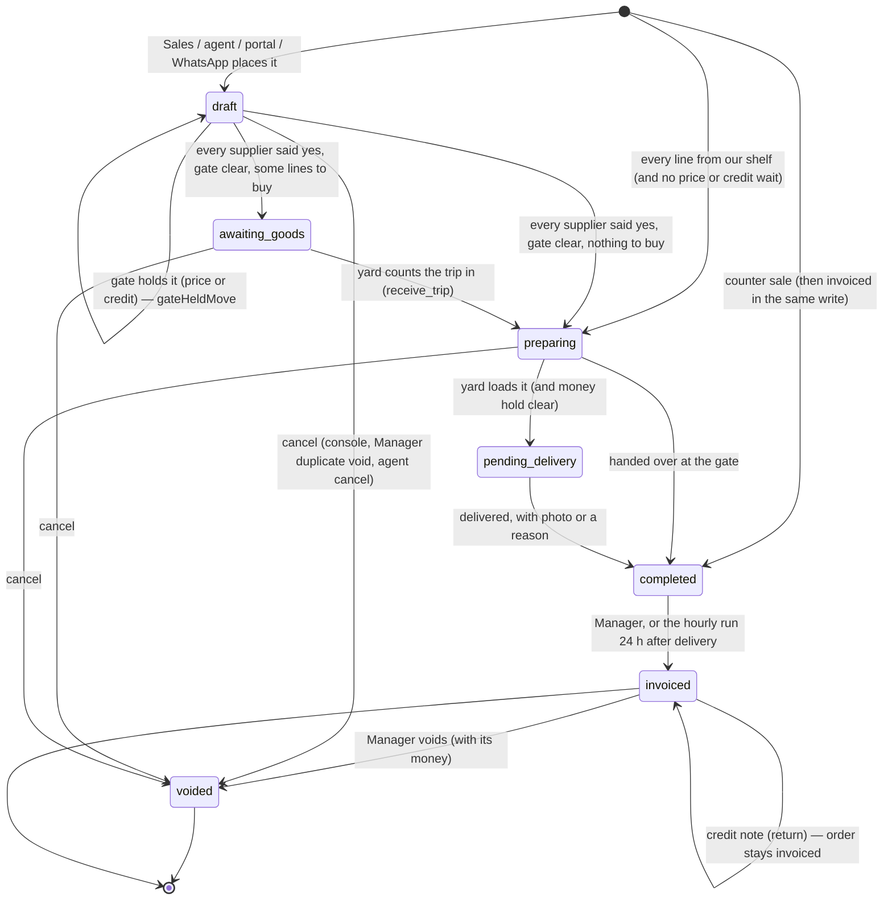

# 01 · The order's journey

**Covers:** every stage and flag of an order (a `saved_quotes` row), who moves it, what each move writes, who gets a push, and what the order carries in `payload`.
**Date:** 2026-10-28
**Status:** reviewed — Kevin's decisions are in §5

Money rules (totals, prices, cost, debt, payments, refunds) are in [02 · Money](02-money.md). This chapter only says *when* money is written, not how it is worked out. Who may decide what is [`docs/decision-rights.md`](../decision-rights.md), which stays binding.

Paths are short: `0119` means `supabase/migrations/0119_shared_foundation.sql` (and so on); `fn/x` means `supabase/functions/x/index.ts`. The latest version of a function wins; where one was redefined, the newest migration is cited.

---

## 1. Stages

An order is one row in `saved_quotes` (`0001:152`). The row has a few real columns; everything else lives in `payload` (section 4).

### 1a. The five stages (`status` column)

| `status` | Plain words | The word on screen | Source of the word |
|---|---|---|---|
| `draft` | Taken. Suppliers are being asked; a price or credit may wait for the Manager. | **Checking** | `sales.html:4605`, `store.html:1746`, `buyer.html:1013`; GLOSSARY "Checking · Buying · Packing · On the road · Delivered" |
| `awaiting_goods` | Some lines are bought in and not here yet. | **Buying** ("Waiting on goods" in the yard) | same; GLOSSARY "Waiting on goods" |
| `preparing` | Everything is here or on our shelf. The yard packs it. | **Packing** ("To pack", then "Packed") | same; GLOSSARY "To pack", "Packed" |
| `pending_delivery` | Packed and on a truck (or a carrier). | **On the road** | same. `manager.html:1606` still has short label "On road" — GLOSSARY says never "On road" |
| `completed` | Left the yard for good: at the door, or collected at the gate. | **Delivered** | same; GLOSSARY "Delivered" |

The apps treat the five as one ordered list (`SQ_STATUS_ORDER`, `manager.html:1609`; `buyer.html:1021` refuses any other value).

### 1b. Flags that sit beside the stage

| Flag | Where | Plain words | Screen word |
|---|---|---|---|
| `invoiced` (+ `invoiced_at`, `invoiced_ts`) | columns | The bill is raised: stock off the books, debt raised, supplier bills made. Only after `completed` (`0139` `ow_invoice_core`: "Only a delivered order is invoiced"). | "INV-0548" (`sales.html:4600` `invoiceLabel`) |
| `voided` | column | Dead. Never comes back (`0122` `saved_quotes_sales_guard`: "A voided order stays voided"). Used both for **void** (after invoice) and **cancel** (before). | "Void" (`manager.html:3277`); agent sees "Cancelled" (`agent.html:7820`) |
| `payload.cancelledAt` | payload | The void was a cancel before invoicing (console `cancelSavedQuote`, `index.html:67253`; Manager duplicate void `manager.html:3590`). | "called off" (`store.html:4065`, 4322) |
| `status = 'cancelled'` | — | Written by `cancel_order` (`0177`), with `voided`, `cancelledAt`, `cancelledByName`, `cancelWhy`; read by `store.html:1597`, `4020`, `4065`. Final: no stage after it. | — |
| `qa` | column (0167) | A test record: kept, listed, in no figure. | "Test · not counted" (GLOSSARY) |
| `payload.gateHeldMove` | payload, server-written | A move out of Checking the gate kept back (section 2c). | "Kept in Checking" (`manager.html:3505`) |
| `payload.pickingStatus` | payload | Inside Packing: none → `in_progress` → `done` (`store.html:2377`, `2389`). | "To pack" / "Packing now" / "Packed" |
| money hold (`ow_money_hold`, `0164`) | computed | Packed, owed, cash customer, Manager has not said "credit". | "Not paid yet" (GLOSSARY) |

`invoiced` and `voided` are flags, not stages; they are drawn as states only to show the end of the road.

---

## 2. Transitions

### 2a. Who can move an order at all

| Move | Decision-rights task | Who does it in the apps | Server check |
|---|---|---|---|
| Place an order | `quote.make` (Sales) | Sales insert (`sales.html:8738`); Edge Functions for agents, portal, WhatsApp | Only `saved_quotes_sales_guard` (`0122:217`: starts neither invoiced nor voided) and the gate |
| Any forward move on the board | `order.move` (Sales, Manager) | Manager "next stage" / "mark done" (`manager.html:3500-3524`); Buyer when the last supplier says yes (`buyer.html:1094` `orderLeaveDraft`) | `0173` `saved_quotes_ow_a_stage_move`, on every write by a person: each move takes `order.move` or the mover's own task (below); other moves refused (OWSTG). No login and the owner's console not judged. Test `stage-move-db` |
| Pack, load, deliver | `order.pick`, `order.load`, `order.deliver` (Store) | Store, worker (`store.html:2368-2453`) | `store_patch_order` (`0164:292`): only `preparing → pending_delivery/completed` and `pending_delivery → completed`; stale write refused (`OWSTALE`, `0162`) |
| Buying → Packing | `stock.receive` (Store) | Store check-in | `receive_trip` (`0157`) moves it itself |
| Invoice | `invoice.make` (Manager); `counter.sell` for a counter sale | Manager app, hourly run, counter sale | `invoice_order` (`0119:967`), `ow_invoice_core` (`0139:85`) |
| Void | `invoice.void` (Manager); `agent.change` for an agent's cancel | Manager app | `saved_quotes_sales_guard` (`0122:236-254`), `saved_quotes_zz_void_money` (`0169:477`), `void_with_money` (`0169`) |

Sales does **not** move stages after placing: `sales.html` sends no `p_status` (its `ordPatch`, `sales.html:3969`, has no status argument).

### 2b. The moves, one by one

| # | From → to | Trigger | Who (task) | Enforced by | Writes | Push (kind → to) |
|---|---|---|---|---|---|---|
| T1 | new → `draft` | Sales slides "place" | Sales (`quote.make`) | Insert by the app (`sales.html:8716-8740`); gate `0119:515` | Row, `payload` (client, items, charges, credit, `takenBy`, `stageLog`) | `price.waits` → `price.approve` if a line waits (`0120:219`); `credit.hold` → `credit.release` if credit holds (`0120:229`, in `saved_quotes_ow_push`, `0120:187`; "no limit set" wording `0167:81`) |
| T2 | new → `preparing` | Every line `supplierId = '__stock__'` | Sales | App picks `preparing` (`sales.html:8731` `nwShelfOnly`); gate also does it for any non-owner draft insert (`0119:560-572`, step 4b), except agent/portal/WhatsApp orders | `stageLog` entry `{auto, shelf}` | as T1 if the gate sends it back to Checking |
| T3 | new → `draft` | Agent sends an order | the agent | `fn/agent-submit-order:640-670` (service key: gate skipped, `0119:533`) | `originAgentId`, `agentClientId`, `agentPaymentStatus: 'unpaid'`, `addonOf` | none found for the insert itself; T1 pushes still fire (the push trigger does not check the login) |
| T4 | new → `draft` | Customer orders in the portal | the customer | `fn/client-submit-order:368` | `originPortal: true`, `note`, `deliverTo` | as T3 |
| T5 | new → `draft` | WhatsApp cart | the customer | `fn/wa-webhook:205` | `originWa`, `originWamid` | as T3 |
| T6 | `draft` → `awaiting_goods` / `preparing` | Last supplier says yes (Buyer), or Manager taps next | Buyer (`supplier.confirm`), Manager (`order.move`) | Who: `0173`. **Front end only** for "every supplier said yes", "no line without a supplier", agent prepay (`buyer.html:1094-1105`). **Server** only for price and credit (gate, `0119:576`; reasons `ow_gate_reason`, `0167:46`) | `stageEnteredAt`, `stageLog`, `supplierConfirms` | `order.buying` → `trip.plan` on entering Buying (`0131:94`) |
| T7 | gate holds T6 | A price waits, or credit holds | — | Gate `0119:576-604`: status kept `draft`, `gateHeldMove {to, at, by, why, terms}` | `gateHeldMove` | `price.waits` / `credit.hold` (`0120`) |
| T8 | `draft` → held target | The write that clears the last decision | Manager (`price.approve` / `credit.release`) | Gate step 4d (`0119:607-619`); a held move goes stale if lines, supplier answers or agent asks change (`ow_gate_terms`, `0119:500`) | status, `stageLog {auto, gate}` | `price.decided` → salesperson (`0120:236`); `credit.decided` → salesperson (`0131:81`) |
| T9 | `awaiting_goods` → `preparing` | Yard counts a trip in; every bought-in line now received | Store (`stock.receive`) | `receive_trip` (`0157`, end of body): skipped while an agent's prepay is unpaid | Line `receivedQty`, `receivedPrice`, `receipts[]`, `receivedAt`, `receivedOnShelf`; **stock + lot + `stock_log` 'restock'** per line; trip `confirmed` | `trip.back`, `trip.difference` etc. are on the trip (`0150`), not the order |
| T10 | inside `preparing` | Packer takes it, ticks lines, finishes on a bay | Store (`order.pick`) | `store_patch_order` allow-list (`0164:296-299`) | `assignedWorkerId`, `pickingStatus`, `pickCursor`, `pickingAssignedAt`, `workerAcceptedAt`, `pickingDoneAt`, `bay`; line `pickStatus`, `pickedQty` | `pick.short` → `pick.settle` when a line is packed short (`0120:244`); packer told by `notify-worker` (named in `0158` header; unverified) |
| T11 | `preparing` → `pending_delivery` | Loaded on a truck | Store (`order.load`) | `store_patch_order`; **money gate** `saved_quotes_ow_money_gate` (`0164:90`): a Store/worker login cannot send out an unpaid cash order (`OWCSH`) | `carrier`, `assignedDeliveryId`, `pickingStatus: 'done'` (`store.html:2401-2405` `applyLoad`) | `job.given` → the driver when a staff driver is named (`0158:100`) |
| T12 | `preparing` → `completed` | Handed over at the gate | Store (`order.deliver`) | same as T11 | `handoverCheckedAt`, `deliveredTo`, `deliveredAt` (`store.html:2416-2425` `handOver`) | `order.delivered` → `invoice.make` (`0120:262`) |
| T13 | `pending_delivery` → `completed` | Driver taps Delivered | Store (`order.deliver`) | `store_patch_order` | `deliveredTo`, `deliveredAt`, `deliveredPhoto` (bucket `delivery-photos`), or `deliveredPhotoKind: 'none'` + `deliveredNote` (`store.html:2437-2455` `markDelivered`) | `order.delivered` → `invoice.make` |
| T14 | any → `completed` | Manager "mark done" | Manager (`order.move`) | Front end (`manager.html:3500` `obMarkDone`); `order.move` checked by `0173`; the gate | `deliveredAt` (no photo) | `order.delivered` |
| T15 | `completed` → invoiced | Manager taps Invoice (10 s undo) | Manager (`invoice.make`) | `invoice_order` (`0119:967`) → `ow_invoice_core` (`0139:85`, deposit use `0165:687`) | Stock off, oldest lots first; supplier bills (`purchase_invoices`); customer debt; `debtCharged`, `invoicedBy`, line `_stockTaken`, `_stockLots`, `_surplusStocked`; `decision_log` line | `order.invoiced` → `invoice.send` (Accounts) and → salesperson (`0138:568-574`) |
| T16 | `completed` → invoiced | 24 h after `deliveredAt` (else `stageEnteredAt`) | the hourly run (no login) | `ow_invoice_due_orders` (`0169:795`; due test `0169:811`), pg_cron `7 * * * *` (`0119:1062`) | as T15; log author "The 24-hour run" | skipped order → `invoice.held` to `price.approve` (OWTPC, OWPRC, OWGIV), `pick.settle` (OWSHP) or `invoice.make` (anything else, incl. OWSML under 1,000, OWWLK walk-in owing) (`0169:833-836`) |
| T17 | new → `completed` + invoiced | Counter sale slide | Sales (`counter.sell`) | `counter_sale` (`0155:30`): shelf lines only, `cash`/`momo`/`bank`, one transaction; under the shop's price → placed as `draft` and returns `waiting: 'price'` | Order, `cash_txns` receipt "Sales Revenue", `payments[]`, `deliveredAt`, invoice (T15), `decision_log` | `price.waits` ("A counter sale waits for your price") if under price; the `order.delivered` push is dropped for counter sales (`0130` `push_outbox_counter_quiet`) |
| T18 | backwards | Manager undo of a move (`manager.html:3520`, `3529`), Store "Unpack" (`store.html:2397`, stays in `preparing`) | Manager, Store | `order.move` (`0173`); refused once invoiced or voided (`0173`, `manager.html:3403`) | `stageLog` (kept merged by `saved_quotes_keep_stage_log`, `0107:127`) | none |
| T19 | invoiced → un-invoiced | "Take back an invoice" | owner console only | `saved_quotes_sales_guard` refuses for Sales/Manager (`0122:233-235`); `saved_quotes_ow_keep_invoice` (`0119:1070`) refuses a stale copy | — | — |

Tests: gate and invoicing `test/shared-foundation-db.test.js`; counter sale `test/counter-sale.test.js`; pushes `test/push-db.test.js`, `test/push-handoffs-db.test.js`; money gate `test/store-money-db.test.js`; delivered → invoice `test/order-delivered-invoice.test.js`; board `test/order-flow-board.test.js`.

### 2c. The Checking gate in one table

`saved_quotes_ow_checking_gate` (`0119:515`), before every insert and update.

| Rule | Detail | Source |
|---|---|---|
| Who it binds | Every login, owner too. Edge Functions and the hourly run (no login) pass. | `0119:531`, header `0119:31-34` |
| Only the Manager writes `priceReview` | Any change, clearing included, from a login without `price.approve` → 42501 (`0175`; `0119:539-557` refused changed objects only). A new cost past the price decided clears it by itself, so the line waits again (what `buyer.html:2912` did) | `0175` `saved_quotes_ow_a_decisions` |
| A price waits | Line has `priceBy`, `priceNote` in `under/nomargin/nocost`, and no `priceReview` matching today's price **and** qty | `ow_line_waits_price`, `0119:452` |
| Credit holds | Customer has a limit and debt + this order > limit; or (0167) the order is on credit (`payload.credit.pct > 0`) and no limit is set; and the Manager has not said `release` (or said `cash` and money is still owed) | `ow_gate_reason`, `0167:46-77` |
| Suppliers' yes (`0174`) | Every supplier on the order has `supplierConfirms[id].state = 'confirmed'` with `terms` = its lines as they stand (`ow_supplier_terms`, = `orderSupplierTerms`) → else 'suppliers' | `buyer.html:1046-1056`; `ow_gate_reason` |
| A line with no supplier (`0174`) | No `supplierId` and the client is not waiting for it (`clientWaits`) → 'unsourced' | `buyer.html:4845` `noneOpen` |
| Agent prepay (`0174`) | The order's agent pays first (`agents.payment_term = 'prepay'`) and `agentPaymentStatus` is not 'paid' → 'prepay' | `buyer.html:1059` |
| Old debt (`0174`, money Q8) | The customer's oldest open debt is past the hold days (21) and the order adds to it → 'credit' | `ow_oldest_debt_days`, `ow_hold_days` |
| Not in the gate | An agent's open change or cancel ask (`agentOrderOnHold`); a line selling under its cost (refused at the bill, `0171`) | `buyer.html:1087` |

---

## 3. Side journeys that hang off an order

| Journey | What happens | Who | Server pieces | Push | Detail |
|---|---|---|---|---|---|
| **Supplier confirmation** | Each supplier on the order says yes, short or none for the exact lines (`terms` = product:variant:qty:cost). A change to the lines makes an old yes "stale". | Buyer (`supplier.confirm`); supplier in the supplier app | `payload.supplierConfirms` written by the Buyer app (`buyer.html:1110`); supplier answers via `fn/supplier-portal:694` (states `confirmed`, `short`, `none`; only while `draft`) | `supplier.answered` → Buyer (`0133:31`) | outline only, to be detailed |
| **Line switched / dropped** | Buyer moves a line to another supplier, our shelf or another item; or drops it | Buyer (`line.switch`, `line.drop`) | `payload.droppedLines[]` (`buyer.html:2674`); a dropped line becomes a Sourcing request (`saved_quotes_dropped_to_sourcing`, `0126:326`) | `line.dropped` → salesperson (`0136:599`); `sourcing.dropped` → `sourcing.lead` (`0131:221`); `item.switch` → salesperson (`0151:160`) | outline only |
| **Client waits** | A line nobody sells stays on the order (`clientWaits`); Sourcing hunts it | Buyer | `saved_quotes_waiting_to_sourcing` (`0139:340`) | `sourcing.found` → Buyer (`0144:51`) | outline only |
| **The price decision** | A line under the shop's price, with no margin, or no cost, waits in Checking for the Manager: Approve, Set price (≥ cost), or Back to the shop's price | Sales proposes, Manager decides (`price.approve`) | Gate (2c). Line keys `priceBy`, `priceNote`, `priceShop`, `priceAt`, `priceAsk` (`sales.html:4436`); `priceReview` (`manager.html:4602`). A supplier's price up past the sale re-opens it (`saved_quotes_ow_price_up`, `0153:119`) | `price.waits` → Manager; `price.decided` → salesperson (`0120`, `0153:98`); `price.changed` → salesperson (`0138:325`) | price math in [02](02-money.md) |
| **Credit hold** | See 2c. Manager answers Release / Cash first / Hold | Manager (`credit.release`) | `payload.creditCheck` written by Manager app (`manager.html:4058`, `4186`) | `credit.hold`, `credit.decided` | limits in [02](02-money.md) |
| **Money at the gate** | A packed, unpaid order for a cash customer cannot leave; the Store asks "let it go on credit?" | Store asks, Manager decides (`credit.release`) | `ow_money_hold`, `store_money_holds`, `saved_quotes_ow_money_gate` (`0164:49-113`); ask = `payload.creditAsk` (phone name `letGoAsk`, `0164:330`) | `credit.ask` → Manager; `credit.ask.decided` → the asker (`0156:125-139`) | — |
| **Buying trip** | Lines to buy go on a trip (`collection_trips`: `open → assigned → collecting → collected → confirmed`, `0070:49`); yard counts it in | Buyer plans (`trip.plan`), Buyer/Store ride (`trip.collect`), Store counts (`stock.receive`) | `receive_trip` (`0157`): trip lines carry `orderId` + `lineId`; `orderId 'restock'` or empty goes to the shelf | `trip.sent`, `trip.taken`, `trip.cancelled`, `trip.back`, `trip.cash`, `trip.difference` (`0150`); `trip.short` → salesperson (`0144:86`) | outline only; trip cash in [02](02-money.md) |
| **Restock buys** | Buying for the shelf, no order (`restock_buys`: `planned / on_trip / collected / cancelled`, plus `held`) | Buyer (`buy.restock`), Manager holds (`restock.hold`) | `0125:59`, `hold_restock_buy` (`0136`), `refuse_restock_buy` (`0158`) | `restock.held`, `restock.released` (`0136:547`), `carton.ask` (`0151:53`), `carton.refused` (`0158:72`) | outline only |
| **Buyer hand-offs** | Paper bill, supplier fix, item switched, yard note, trip cash, own money | Buyer → others | `buyer_handoffs` (`0125:87`) | `bill.paper`, `sourcing.fix`, `item.switch`, `trip.yard_note`, `trip.own_money` (`0134`, `0151`) | outline only |
| **Short pick** | Packer found less. Manager: "Bill what went" (line qty cut to picked) or "Bill the full quantity" (`pickShortfallAckAt`) | Store reports, Manager decides (`pick.settle`) | Read by `ow_pick_shortfall` (`0119:755`); invoicing refuses until settled (OWSHP). **The settle is written by the Manager app only** (`manager.html:5196-5211` `ACT.spgo`, `pickSettle`) | `pick.short` → Manager | — |
| **Invoice** | T15–T17 | Manager, hourly run, counter sale | one function, `ow_invoice_core` | `order.invoiced`, `invoice.held` | what it books: [02](02-money.md) |
| **Return → credit note** | Goods come back. Store/Sales/Accounts ask; Manager raises the credit note; goods back on the shelf if ticked | ask: Store, Sales, Accounts; decide: Manager (`credit_note.raise`) | Ask: `invoice_asks` kind `credit` (`0123:559`); Store's ask priced in the database, never more than the line has left (`store_return_ask`, `0164:391`). Note: `payload.creditNotes[]` written by Manager app (`manager.html:5385-5397`), then `manager_stock_move` 'reversal', then `decide_invoice_ask` — **three writes**. Server caps notes at the bill (`saved_quotes_zz_money_check`, `0169:448`) | `invoice.ask` → Manager; `invoice.ask.decided` → asker (`0131:123-132`) | refund money in [02](02-money.md) |
| **Void (after invoice)** | Manager voids, with its money: refund or deposit | Manager (`invoice.void`); Sales/Accounts ask | `void_with_money` (`0169`) when money was paid; plain void = `voided: true` by the app (`manager.html:5510`); goods back = `manager_stock_move` of `_stockTaken`; `void_sale_bills`; `decide_invoice_ask` — **up to four writes** (`manager.html:5500-5521`). Log line by `saved_quotes_sales_guard` (`0122:248`) | `invoice.ask`, `invoice.ask.decided` | money in [02](02-money.md) |
| **Cancel (before invoice)** | Order called off; Store puts back what was packed | `order.cancel` (Manager) — **Built: no** in decision-rights §2 | Done today as a void: console `cancelSavedQuote` (`index.html:67239`, bills what came in), Manager duplicate void (`manager.html:3581`, `why: 'duplicate'`), agent cancel closed by `agent.change` (`0122:242-244`). Store screen for it exists (`store.html:4322` `pkCancel`) | none found | outline only |
| **Delivery proof** | Photo of the goods at the door, or a reason | Store (`order.deliver`) | Upload to storage bucket `delivery-photos` (`0111`), path on `deliveredPhoto` (`store.html:2443`); `deliveredNote` allowed by `store_patch_order` (`0160`) | — | — |
| **Counter sale** | Walk-in, pay and go, shelf only | Sales (`counter.sell`) | T17. History: `0047`, `0130` (quiet push), `0136` (one write), `0155` (`p_ref`) | — | money in [02](02-money.md) |
| **Agent orders** | Agent sends; may add on to a live order (`addonOf`, only while `draft/awaiting_goods/preparing`, `fn/agent-submit-order:291`); asks change or cancel | agent proposes, Manager decides (`agent.change`) | `fn/agent-submit-order`, `fn/agent-change-order` (`agentChange {state 'asked'…}`, `agentCancel`); prepay agent: not packed until paid (`receive_trip` `0157`; Buyer `buyer.html:1059`) | `agent.change`, `agent.cancel` → Manager (`0120:251`, `0120:256`) | outline only, to be detailed |
| **Client portal orders** | Customer with a portal account orders | the customer | `fn/client-submit-order:368` (`originPortal`); nothing branches on it (comment at `:388`) | none found | outline only |
| **WhatsApp orders** | A WhatsApp cart becomes a draft | the customer | `fn/wa-webhook:205` | none found | outline only |

---

## 4. What lives in `payload`

"Server" = a database function writes it, or a guard checks it. "App" = only the front end writes it, and the database takes whatever comes. Apps merge their keys through `ow_patch_order` (`0165:463`, security invoker), which refuses only `payments`, `debtCharged`, `amountPaid` (`0165:474`).

### 4a. Order keys

| Key | What | Written by | Checked by the server? |
|---|---|---|---|
| `client {name, phone}` | Who it is for (also in columns `client_name`, `client_phone`) | Sales, Edge Functions | No |
| `customerId` | The customer record | Sales; Accounts may change it (`0138:601` free keys) | Read by the gate, money hold, invoicing |
| `items[]` | The lines (4b) | Sales, Buyer, Manager, Store (pick keys only), `receive_trip` | Counts/prices ≥ 0, invoiced line at 0 needs `givenAway` (`0169` money check) |
| `charges[]`, `credit` | Delivery fees; credit terms (`credit.pct`) | Sales (`sales.html:8730`) | In totals; `credit.pct` read by the gate (`0167:71`) → [02](02-money.md) |
| `payments[]` | Money taken on the order | Only `receive_payment`, `counter_sale`, `ow_correct_payment`, `void_with_money` | Yes, `saved_quotes_zz_money_check` (`0165`, `0169`) → [02](02-money.md) |
| `debtCharged` | The invoice's share of the customer's balance | `ow_invoice_core`; `saved_quotes_zz_sync_debt` | Yes → [02](02-money.md) |
| `takenBy` | Salesperson's login id | Sales, `counter_sale` | No; it is the push address for "tell them" pushes |
| `savedAt`, `createdAt` | When saved / first sent | all writers | No |
| `stageEnteredAt`, `stageLog[] {status, at, auto?, shelf?, gate?, counter?, by?}` | Clock and history of stages | all movers | Merged, never shrunk, by `saved_quotes_keep_stage_log` (`0107:127`) |
| `gateHeldMove {to, at, by, why, terms}` | A move the gate kept back | Server only | Yes (`0119`) |
| `supplierConfirms {[supplierId]: {state, at, askedAt, terms, note, readyOn, by, via?}}` | Each supplier's answer | Buyer app (`buyer.html:1110-1120`) | Only as part of `ow_gate_terms` (staleness) |
| `droppedLines[]` | Lines taken off at Checking, with reason | Buyer | Triggers pushes and a Sourcing request |
| `shopConfirmedAt`, `shopConfirmedTerms` | Shop confirmed a prepay agent's order | Buyer (`buyer.html:1088`) | No |
| `creditCheck {decision: release\|cash\|hold, by, byName, at, over, ask?}` | Manager's credit answer | Manager app | Read by gate and money hold; written only with `credit.release` (`0175`) |
| `creditAsk {at, by, byName, carrier, answer}` | Store's "let it go on credit?" | Store (`store_patch_order`), Manager answers | Pushes only |
| `assignedWorkerId`, `pickingStatus`, `pickCursor`, `pickingAssignedAt`, `workerAcceptedAt`, `pickingDoneAt`, `bay` | Packing | Store; Manager hands over (`manager.html:1994` `PACK_KEYS`) | Store logins limited to these by `store_patch_order` |
| `pickShortfallAckAt`, `pickSettle {pick: went\|full, by, byName, at, lines[{idx, ordered, picked}]}` | Short pick settled | Manager app | Read by `ow_pick_shortfall`; set only with `pick.settle` (`0175`; clearing `pickShortfallAckAt` when a pick starts again is free) |
| `assignedDeliveryId` (staff id, `__carrier__`, `__agent__`, `__client__`), `carrier {kind, name, what, phone, at, by, staffId?}` | Who takes it out | Store (`store.html:2401-2404`), Manager | `job.given` push |
| `deliveredTo`, `deliveredAt`, `deliveredPhoto`, `deliveredPhotoKind (note\|none)`, `deliveredNote`, `handoverCheckedAt` | Proof of delivery | Store; Manager "mark done" writes only `deliveredAt` | `deliveredAt` starts the 24 h clock (`0169:811`) |
| `invoicedBy {via, by, byName, at}` | Who invoiced | `ow_invoice_core` | Yes; protects against a stale un-invoice (`0119:1070`) |
| `creditNotes[] {id, no, date, reason, lines[{idx, qty, price, name}], amount, restocked, refund, askId, by, byName, voided?}` | Returns credited | Manager app (`manager.html:5395`) | Total capped at the bill; written only with `credit_note.raise` (`0175`) |
| `voidedBy {by, byName, at, why, askId \| keeps}`, `cancelledAt`, `voidMoney` | Why and how it was voided | Manager app; `void_with_money` writes `voidMoney` | `voidMoney.done` checked by `0169:468` |
| `cancelledByName`, `voidedAt` | Shown on the Store's "called off" screen | **No writer found** (only in the Store allow-list, `0164:179`) | — |
| `docLog[] {at, kind, what}` | Order's paper trail (last 60) | Manager app | No |
| `invoiceSends` | When the invoice was sent | Accounts (`accounts.html:1893`) | Accounts may write only this and money keys (`0138:601`) |
| `givenAway {why, by, at}` (on a line) | Line billed at 0 on purpose | Manager | Yes (`OWGIV`, `0169:381`) |
| `counter` / `counterSale` | A counter sale | `counter_sale`, Sales | Read by `invoice_order` (`0119:987`) and the push quieter |
| `originAgentId`, `agentClientId`, `agentPaymentStatus`, `addonOf`, `deliveryMode`, `deliveryAddress`, `agentChange`, `agentCancel`, `agentCancelWhy`, `agentCredit` | Agent orders | Edge Functions; Manager (`agentCredit`, `agentChange` decisions) | `originAgentId` read by the gate (shelf skip), money hold, `receive_trip` |
| `originPortal`, `note`, `deliverTo` / `originWa`, `originWamid` | Portal / WhatsApp orders | Edge Functions | `originPortal`, `originWa` read by the gate (shelf skip) |
| `costAsked`, `dupOkWith` | Manager bookkeeping | Manager app | No; meaning unverified |

### 4b. Line keys (`items[i]`)

| Key | What | Written by | Server? |
|---|---|---|---|
| `lineId`, `productId`, `variantIdx`, `productName`, `unit`, `packUnit`, `packQty`, `qtyIn`, `qty` | The item and how many | Sales (`sales.html:8726`); Buyer switches | `qty` ≥ 0; `lineId` matches trip lines in `receive_trip` |
| `supplierId` (`'__stock__'` = our shelf, empty = nobody yet), `supplierName` | Where it comes from | Sales, Buyer; `receive_trip` rewrites to the trip's supplier | Read everywhere (shelf skip, counter sale, Buying) |
| `price` (cost), `sellPrice` | Cost and selling price | Sales; Buyer (`line.reprice`) | ≥ 0 → [02](02-money.md) |
| `priceBy`, `priceNote` (`under\|nomargin\|nocost`), `priceShop`, `priceAt`, `priceAsk` | A price that needs the Manager | Sales (`placedPriceTag`, `sales.html:4436`); Buyer sets `nomargin` | Read by the gate |
| `priceReview {state: approved\|changed, price, was, qty, by, byName, at}` | The Manager's decision | Manager (`manager.html:4602`, `4918`) | Only `price.approve` may write it |
| `clientWaits` | Kept on the order while Sourcing hunts it | Buyer | Starts a Sourcing request (`0139`) |
| `receivedQty`, `receivedPrice`, `receipts[]`, `receivedAt`, `receivedOnShelf` | What came in | `receive_trip` only | Server |
| `pickStatus` (`pending\|done\|short`), `pickedQty` | Packing | Store | via `store_patch_order` |
| `_stockTaken`, `_stockLots`, `_surplusStocked` | What the invoice took off the shelf | `ow_invoice_core` | Server; void puts `_stockTaken` back |
| `givenAway` | see 4a | Manager | Server |

The Store never sees money: its copy of an order is cut to an allow-list by `ow_store_payload` (`0164:176`).

---

## 5. Decided (Kevin, 2026-10-28)

Each question raised in the first draft, with Kevin's answer. The evidence
stays so the builder can find the old code. **Server** = becomes a database
rule (see `docs/rebuild.md`, "Backend fixes decided").

| # | Was | Decided | Evidence |
|---|---|---|---|
| Q1 | "Every supplier said yes", "no line without a supplier" and agent prepay are checked only in the Buyer app | **Server:** the Checking gate checks them too, so no app can move an order past them. **Built: `0174`** | `ow_gate_reason` `0167:46-77`; `buyer.html:1094-1105`; `manager.html:3509-3517` |
| Q2 | `order.move` is granted but never checked; any Sales, Buyer or Manager login can set any status | **Server:** moving a stage needs `order.move`, and only to the next allowed stage. **Built: `0173`** — Checking → Buying/Packing `order.move` or `supplier.confirm`; Buying → Packing `order.move` or `stock.receive`; Packing → On the road `order.move` or `order.load`; → Delivered from Packing/On the road `order.move` or `order.deliver`, from any stage `order.move` ("mark done"); back `order.move`; invoiced or voided: stays; a new order placed past Checking is a move out of it (Packing also `quote.make`) | `0165:463` (`p_status` taken as given) |
| Q3 | Manager "next" from Checking always goes to Buying | When every line is on our shelf, "next" goes straight to **Packing** | `manager.html:3512-3513` vs `buyer.html:1103` |
| Q4 | Manager "mark done" skips the delivery proof and starts the 24 h invoice clock | "Mark done" **asks for a reason**, kept on the order and in the log; the Store's delivery with proof stays the normal path | `manager.html:3500-3505`; decision-rights §2 `order.deliver` |
| Q5 | `creditCheck`, `pickSettle` and `creditNotes` have no server task check | **Server:** each needs its task (`credit.release`, `pick.settle`, `credit_note.raise`). **Built: `0175`** | `0156`/`0164`; `0169:448` |
| Q6 | A void and a credit note are several writes; a lost signal leaves half of one | **Server:** each is **one database write**, like payments and the counter sale. **Built: `0176`** `void_invoice`, `raise_credit_note` | `manager.html:5385-5398`, `5500-5521` |
| Q7 | Three ways void an unbilled order; the Store is not told to stop packing | **One "Cancel" action**, by the Manager (`order.cancel`; Sales asks). It puts back what was packed and pushes the Store and Sales. **Built: `0177`** `cancel_order` (Sales' ask not built) | `index.html:67239`; `manager.html:3581`; `0122:242-244`; `store.html:4322-4326` |
| Q8 | `status = 'cancelled'` is read but never written | Cancel writes `status = 'cancelled'` with `cancelledAt` and `cancelledByName`, which the Store screen already reads. **Built: `0177`** | `store.html:1597`, `4020`, `4065`, `4322-4326` |
| Q9 | decision-rights says the Manager is told of a counter sale; `0130` removed the push | **Log only.** A counter sale waits on nobody, so no push; decision-rights now says so | `0130:36` `ow_push_counter_quiet` |
| Q10 | `deliveredAt` is ISO text in some places, milliseconds in others | One shape: ISO text | `0155`; `sales.html:11033`; `0119:130` `ow_ts` |
| Q11 | decision-rights' `priceReview` shape leaves out `qty` | `qty` is part of it (a decision goes stale when the qty changes); decision-rights now says so | `0119:465`; `manager.html:4602` |
| Q12 | The Buyer can wipe a Manager's price decision (`priceReview = null`) from any login | **Server:** only `price.approve` changes or clears it; a new cost that leaves no margin flags the line for the Manager instead. **Built: `0175`** (the database clears the decision when the cost passes it) | `buyer.html:2912`; `0119:544` |
| Q13 | "On road" in the Manager app | "On the road", as the glossary says | `manager.html:1606` |
| Q14 | Sales reads the name from `payload.client`, the Manager from `client_name` | One place: the `client_name` column | `sales.html:3962` vs `manager.html:1156` |

### Not verified

- What `notify-worker` sends a packer, and whether it is the only "packer told" path (named in the `0158` header only).
- The full list of `supplierConfirms.state` values the Buyer app writes (seen: `confirmed`, `problem`, `pending`; the supplier portal sends `confirmed`, `short`, `none`).
- What `costAsked`, `dupOkWith`, `agentCredit` and `runDriver` mean.
- How a supplier who delivers to the yard (GLOSSARY "Delivery (supplier)") is received — assumed to be a trip through `receive_trip`.
- Whether the console (`index.html`) moves stages in ways not listed here; only its cancel and invoice paths were read.
