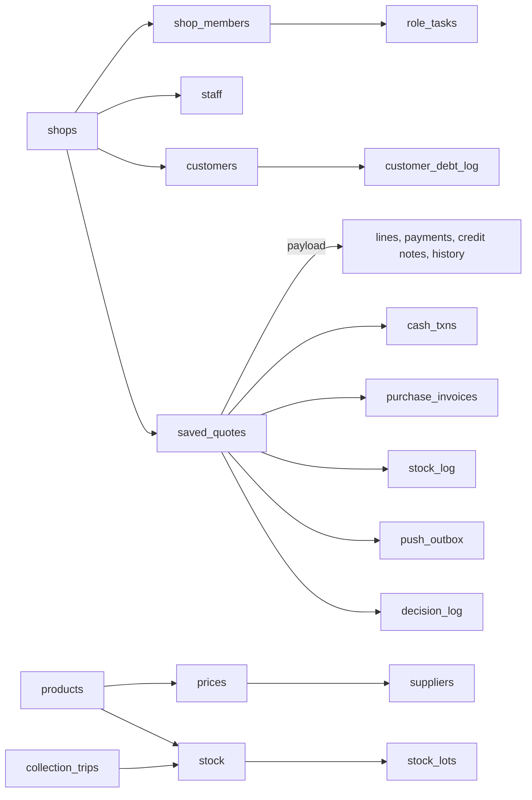

# 05 · Data

What this covers: every table the apps and the server use, what each holds, who may read and write it, what lives inside JSON fields, the actions only the server may take, and how rows are numbered.
Date: 2026-10-28
Status: **decided — Kevin took every recommended answer in §8 on 2026-10-28**; Q1 and Q2 built in 0179

---

## 0. How to read this chapter

**Source.** A database built from every migration, `0001` to `0178`, in order (the same build the tests use, `test/fixtures/supabase-shim.sql` then `supabase/migrations/`), read on 2026-10-28. The access columns are worked out from its row-level security, not from comments; the tables' "Holds" from the migration that made each.

**Scale.** 89 tables, all with row-level security on. 173 functions an app login may call; 45 of them check a task (§5). 44 JSON fields (§4).

**Words.** *Members*: anyone in the shop (`shop_members`). *Owner*: the owner or an admin (`is_shop_admin`). *`task.name`*: a login whose role holds that task (`has_task`, `role_tasks`, `docs/decision-rights.md`). *Not yard*: refused to a Store login, which reads and writes only through its own functions (0164). *The agent*: an agent's own rows. *Functions only*: no app may write the table; a server function does.

The order itself — every key of `saved_quotes.payload` — is in [01 §4](01-order-journey.md). The money rules are in [02](02-money.md).

---

## 1. The shape

- **One shop's books** in every table, by `shop_id`. Two shops sit in the picker: the books, and the old books before the fresh start (0148).
- **Roles** (`shop_members.role`, 0128): owner, admin, manager, sales, buyer, store, accounts, sourcing, staff. A role's powers are its tasks in `role_tasks`; a shop can switch one off (`shop_task_off`, 0127).
- **Agents and customers** are not members: they reach the data through edge functions with their own logins (`agents`, `client_accounts`, `supplier_accounts`).

---

## 2. Who can do what: four layers

| Layer | What it does | Where |
|---|---|---|
| 1. Table rule | Members read and write their shop's rows. Most deletes are the owner's alone (0083). | row-level security, every table |
| 2. Narrowing rule | "Not yard" on 76 tables (0164); "owner, or the task" on the money, stock, price and product tables (0122 onward) | restrictive policies |
| 3. Order guards | Every write to `saved_quotes` passes 14 checks before it lands; 10 more run after it (pushes and bookkeeping) | triggers, below |
| 4. Server actions | A decision that must be whole is one function, with its task (§5) | `security definer` functions |

**The order guards** (`saved_quotes`, in the order they run):

| Before the write | What it refuses or keeps | Made in |
|---|---|---|
| `accounts_guard` | an Accounts login changing the order itself | 0117 |
| `keep_stage_log` | a stage history that shrinks | 0107 |
| `ow_a_decisions` | a Manager decision written without its task; clears a price decision a new cost passes | 0175 |
| `ow_a_stage_move` | a stage move without its task, or to a stage not next | 0173, 0178 |
| `ow_checking_gate` | leaving Checking while a price, credit, supplier, line or prepay waits | 0119, 0174 |
| `ow_keep_invoice` | a stale copy taking an invoice back | 0119 |
| `ow_money_gate` | the yard sending out an unpaid cash order | 0156, 0164 |
| `ow_qa` | marks a test record | 0167 |
| `sales_guard` | invoicing by a save; un-voiding; a void or cancel without its task | 0122, 0177 |
| `sync_agent_id` | keeps `agent_id` in step with the payload | 0027 |
| `zz_cost_floor` | a price under cost; a bill with a line under cost | 0171 |
| `zz_money_check` | counts or prices below 0, payments that do not match their receipts, credit notes past the bill | 0165, 0169 |
| `zz_sync_debt` | keeps the customer's balance equal to what the bill owes | 0165 |
| `zz_void_money` | a void that keeps money paid on it | 0169 |

After the write: the pushes (`ow_push` 0120, `ow_push2` 0131, `ow_push3` 0136, `ow_push4` 0138, `ow_push_job` 0158, `ow_push_money` 0156, `ow_price_up` 0153), `dropped_to_sourcing` (0126), `waiting_to_sourcing` (0139), `sync_id_seq` (0017).

---

## 3. The tables

Read and write as the database allows a login on its own; a server function may do more.

### Orders and selling

| Table | Holds | Read | Write |
|---|---|---|---|
| `saved_quotes` | Every order: one row, its lines and history in `payload` (01 §4) | the agent or members · not yard | members · not yard |
| `invoice_asks` | An ask to void a bill or credit a return, and its answer (0123) | members · not yard | own rows · not yard |
| `payment_asks` | An ask to Accounts to correct a payment (0130) | members · not yard | own rows · not yard |
| `store_asks` | The yard asks the Buyer or Manager for more stock or a recount (0157) | members | yard logins |
| `payment_promises` | A customer's promise to pay by a day (0089) | members · not yard | owner or `promise.record` · not yard |
| `statements_sent` | Each statement sent to a customer (0101) | members · not yard | owner or `statement.send` · not yard |
| `follow_ups` | Sourcing's reminders on an ask (0077) | members · not yard | owner or `sourcing.ask`, `sourcing.lead` · not yard |
| `sourcing_leads` | Items asked for that the shop does not list yet (0072) | members · not yard | owner or `sourcing.ask`, `sourcing.lead` · not yard |
| `search_misses` | Searches that found nothing, for Sourcing (0146) | `sourcing.lead` · not yard | nobody · functions only |
| `search_mutes` | Search misses Sourcing chose to ignore (0146) | `sourcing.lead` · not yard | `sourcing.lead` · not yard |
| `solution_templates` | An agent's saved bundles of items (0026) | the agent · not yard | the agent · not yard |
| `catalogues` | An agent's public catalogue page (0025) | the agent · not yard | the agent · not yard |
| `catalogue_inquiries` | Questions sent from a public catalogue (0025) | the agent · not yard | the agent · not yard |

### Customers and debt

| Table | Holds | Read | Write |
|---|---|---|---|
| `customers` | Customers: name, phone, credit limit and terms, `debt` (kept by the server) | members · not yard | `customer.edit`, `payment.receive` · not yard |
| `customer_debt_log` | Every charge and payment on a customer's balance (02 §5) | members · not yard | owner or `payment.edit`, `payment.receive` · not yard |
| `fresh_starts` | The fresh start of the books, once (0148) | members · not yard | nobody · functions only |

### Money (the treasurer)

| Table | Holds | Read | Write |
|---|---|---|---|
| `cash_txns` | The cash book: every receipt and payment, by account (cash, momo, bank) | members · not yard | owner or `agent.pay`, `asset.edit`, `bill.pay`, `cash.expense` +9 · not yard |
| `cash_days` | The daily close: opening and counted cash per account | members · not yard | owner or `day.count` · not yard |
| `purchase_invoices` | Bills from suppliers, raised at the invoice or on a trip | members · not yard | owner or `bill.pay`, `bill.record`, `consign.settle` · not yard |
| `dues` | Monthly commitments (rent, wages) and what was paid (0046) | members · not yard | owner or `payroll.run` · not yard |
| `loans` | Loans taken, their charges and repayments (0043) | members · not yard | owner or `loan.edit` · not yard |
| `fixed_assets` | Assets bought, their wear and sale (0042) | members · not yard | owner or `asset.edit` · not yard |
| `rent_agreements` | Rent the shop pays (0046) | members · not yard | owner · not yard |
| `supplier_commissions` | Commission a supplier owes on agents' sales (0020) | members · not yard | owner · not yard |

### Stock and the yard

| Table | Holds | Read | Write |
|---|---|---|---|
| `stock` | How many of each item (or variant) is on the shelf: one row per stock key | members | owner · not yard |
| `stock_lots` | The cost of what is on the shelf, oldest first; must add up to `stock` (0169) | members · not yard | owner · not yard |
| `stock_log` | Every stock move: sale, restock, count, write-off, return | members · not yard | owner · not yard |
| `stock_counts` | A blind stock take and its answer (0115, 0161) | members | `stock.count` |
| `stock_reports` | Damaged or missing stock reported by the yard (0122) | members | `stock.report` |
| `collection_trips` | A buying trip: supplier, lines, runner, cash, the yard's count (0070) | members · not yard | members · not yard |
| `restock_buys` | A line to buy for the shelf, not for an order (0125, 0136) | members · not yard | owner or `buy.restock`, `trip.collect` · not yard |
| `buyer_handoffs` | The Buyer's hand-offs: paper bill, fixes, switched item, cash back (0125) | members · not yard | owner or `bill.record`, `line.switch`, `price.list`, `quote.make` +6 · not yard |
| `places` | Delivery places on the map (0066) | members | owner |
| `place_routes` | Road routes locked for the shop (0115) | members | `route.lock` |
| `road_names` | Directions named by the Store (0124) | members | `route.lock` |

### Products, prices and suppliers

| Table | Holds | Read | Write |
|---|---|---|---|
| `products` | Items for sale: name, unit, variants, markups | members · not yard | owner or `product.edit` · not yard |
| `prices` | Each supplier's price for an item, with tiers | members · not yard | owner or `price.confirm`, `price.list` · not yard |
| `rival_prices` | Other shops' prices seen (0087) | members · not yard | owner or `price.list` · not yard |
| `product_links` | Related items (0090) | members · not yard | owner or `product.edit` · not yard |
| `item_names` | Other names an item is asked for by (0112) | members or owner · not yard | owner or `product.edit` · not yard |
| `item_twins` | Two listings that are one item (0152) | members · not yard | owner or `product.edit` · not yard |
| `suppliers` | Suppliers: name, phone, terms, score | members · not yard | owner or `supplier.edit` · not yard |
| `supplier_accounts` | A supplier's login to the supplier app (0132) | owner · not yard | owner · not yard |
| `supplier_sessions` | Signed-in supplier phones (0132) | members · not yard | owner · not yard |
| `supplier_answers` | A supplier's yes / no / short on an order (0132) | members · not yard | owner · not yard |
| `supplier_proposals` | A supplier's new price, waiting for the shop (0132) | members · not yard | owner · not yard |

### People, roles and settings

| Table | Holds | Read | Write |
|---|---|---|---|
| `shops` | The shop (two in the picker: the books and the old books) | members | owner |
| `shop_members` | Who is in the shop and their role (owner, manager, sales, buyer, store, accounts, sourcing, staff) | members · not yard | owner |
| `staff` | Staff records: name, phone, role in the yard, login (`user_id`) | members · not yard | owner · not yard |
| `role_tasks` | Which tasks each role holds (`docs/decision-rights.md`) | own rows | nobody · functions only |
| `shop_task_off` | A role's task switched off in one shop (0127) | members · not yard | nobody · functions only |
| `app_settings` | The shop's settings, all in `presets` (§4) | members · not yard | owner · not yard |
| `login_sessions` | Which phones are signed in, for the owner (0062) | owner · not yard | members or owner · not yard |
| `member_presence` | Who is on now, in chat (0170) | members | nobody · functions only |
| `entity_id_counters` | The next customer, product and supplier id (C1000, P123) (0032, 0135) | nobody · functions only | nobody · functions only |

### Decisions, pushes and notes

| Table | Holds | Read | Write |
|---|---|---|---|
| `decision_log` | The owner's log: every decision, who, before and after (0119) | owner or `finance.see`, `price.confirm` · not yard | members · not yard |
| `manager_notes` | The Manager's targets, reviews and notes (0081) | members · not yard | owner · not yard |
| `briefs_sent` | Daily briefs sent (0091) | members · not yard | owner · not yard |
| `push_outbox` | Every push, written in the same write as its hand-off (0120) | own rows · not yard | nobody · functions only |
| `push_subscriptions` | A login's phones, for pushes (0011, 0120) | own rows | own rows |

### Agents (`agent.html`, edge functions)

| Table | Holds | Read | Write |
|---|---|---|---|
| `agents` | Sales agents outside the shop, their terms (prepay or on delivery) | members or own rows or owner or `agent.pay`, `finance.see` | owner · not yard |
| `agent_clients` | An agent's own customers | the agent · not yard | the agent · not yard |
| `agent_clusters` | An agent's groups of clients | the agent · not yard | the agent · not yard |
| `agent_goals` | An agent's daily and monthly targets | the agent · not yard | the agent · not yard |
| `agent_promotions` | Bonuses the shop offers agents on items | owner · not yard | owner · not yard |
| `agent_requests` | An agent's ask for an item the shop lacks (0112) | the agent or owner or `sourcing.lead` · not yard | the agent or owner or `sourcing.lead` · not yard |
| `agent_shoutouts` | The shop's messages to agents (0111) | the agent or owner · not yard | owner · not yard |
| `agent_feed_events` | What an agent saw in their feed (0102) | the agent or owner · not yard | the agent · not yard |
| `agent_feed_pins` | Items pinned to the agents' feed (0102) | the agent or owner or `product.edit` · not yard | owner or `product.edit` · not yard |
| `agent_feed_prefs` | An agent's feed settings (0102) | the agent · not yard | the agent · not yard |
| `agent_notify_prefs` | Which pushes an agent wants (0110) | the agent or owner · not yard | the agent · not yard |
| `agent_price_snapshots` | Prices as an agent last saw them, for "price changed" pushes (0110) | owner · not yard | nobody · functions only |
| `agent_push_log` | Pushes sent to agents (0103) | the agent or owner · not yard | nobody · functions only |
| `agent_push_subscriptions` | An agent's phones, for pushes (0103) | the agent or owner · not yard | the agent · not yard |
| `agent_mobile_payments` | Mobile money prompts and their outcome (0022, 0109) | the agent or members · not yard | nobody · functions only |
| `agent_commission_claims` | An agent's monthly bonus claim (0014) | the agent or owner or `agent.pay`, `finance.see` · not yard | owner or `agent.pay` · not yard |
| `shop_payment_providers` | MTN and Airtel keys for mobile money (0022) | owner · not yard | owner · not yard |

### Customer portal, WhatsApp and media

| Table | Holds | Read | Write |
|---|---|---|---|
| `client_accounts` | A customer's login to the portal (0096) | owner · not yard | owner · not yard |
| `client_sessions` | Signed-in portal phones (0096) | members · not yard | owner · not yard |
| `wa_numbers` | The shop's WhatsApp numbers (0052) | members · not yard | owner · not yard |
| `wa_conversations` | A WhatsApp chat and its salesperson (0052, 0170) | members · not yard | members · not yard |
| `wa_messages` | Every WhatsApp message in or out (0052) | members · not yard | nobody · functions only |
| `wa_conv_events` | What happened to a chat: taken, handed, moved (0170) | members | nobody · functions only |
| `wa_notes` | Team notes on a chat, never sent (0170) | members | members |
| `wa_campaigns` | WhatsApp broadcasts (0056) | members · not yard | nobody · functions only |
| `wa_posts` | Status posts (0051) | members · not yard | owner · not yard |
| `wa_quote_pack` | Quick-quote packs for WhatsApp (0094) | members · not yard | owner · not yard |
| `media` | Photos (0049) | members · not yard | owner · not yard |
| `media_folders` | Photo folders (0049) | members · not yard | owner · not yard |

**Deletes.** The owner's alone on most tables. Exceptions: an agent deletes its own clients, groups, goals, templates and phones; a login deletes its own push phones; nobody deletes log and ask tables (`decision_log`, `invoice_asks`, `payment_asks`, `store_asks`, `stock_counts`, `stock_reports`, `push_outbox`, the `wa_*` history) — they are history.

---

## 4. Data inside JSON fields

| Field | Holds | Written down in |
|---|---|---|
| `saved_quotes.payload` | the whole order: lines, client, charges, credit, payments, credit notes, decisions, stage history, delivery | [01 §4](01-order-journey.md) |
| `app_settings.presets` | the shop's settings: `defaultMarkup`, `creditPct`, `creditHold.days` (21), `chaseAfterDays`, `priceReview.perDay`, `shopPhone`, `shopAddress`, `waPhone`, `supplierTieBand`, `supplierScore`, `services`, `categories`, `orderStageLimits`, `sourcingLimits`, `restockCoverDays`, `reorderRules`, `bays`, `digestHour`, `expenseCategories` and more | not yet: §8 Q4 |
| `app_settings.quote_draft` | a half-made order on the console | — |
| `collection_trips.lines`, `.pay`, `.cash_count` | a trip's lines (what to buy, what came, what the yard counted), its money, its cash count | 01 §3 (trips) |
| `prices.tiers`, `rival_prices.tiers` | price breaks by quantity | 02 §3 |
| `products.variants`, `.variant_attributes` | an item's sizes and colours | — |
| `purchase_invoices.payload` | a supplier's bill and its lines | 02 §7 |
| `decision_log.before`, `.after`, `.ref` | the decision, as it was and as it became | 03 (decision rights) |
| `push_outbox.ref` | what a push opens | 06 |
| `stock_counts.lines`, `.missing` | a stock take's counts | — |
| the rest | `agent_feed_prefs.prefs`, `agent_notify_prefs.kinds`, `agent_mobile_payments.raw_response`, `buyer_handoffs.payload`, `.cash_back`, `cash_days.opening`, `.actual`, `dues.payload`, `follow_ups.payload`, `fresh_starts.confirmed`, `.old_debts`, `invoice_asks.lines`, `loans.payload`, `manager_notes.body`, `payment_asks.want`, `place_routes.line`, `shop_payment_providers.credentials`, `solution_templates.line_items`, `sourcing_leads.candidates`, `.requests`, `.variant_attrs`, `store_asks.payload`, `supplier_accounts.prefs`, `supplier_answers.changes`, `supplier_proposals.payload`, `wa_messages.payload`, `wa_quote_pack.items` | the migration that made each |

---

## 5. Actions only the server takes

Each is one function, one transaction, with the task it checks. The new apps call these; they never write the tables underneath.

| Role | Function → task |
|---|---|
| Sales | `counter_sale` → `counter.sell`; `receive_payment` → `payment.receive`; `take_conversation`, `hand_conversation` → `chat.take`; `tell_customer_change` → `customer.edit` |
| Manager | `invoice_order` → `invoice.make`; `void_invoice`, `void_with_money`, `void_sale_bills` → `invoice.void`; `raise_credit_note` → `credit_note.raise`; `cancel_order` → `order.cancel`; `merge_customers` → `customer.merge`; `set_product_markup` → `markup.set`; `set_person_goal` → `goal.set`; `accept_stock_count`, `ask_recount` → `stock.correct`; `write_off_stock`, `dismiss_stock_report` → `stock.writeoff`; `accept_trip_difference` → `trip.difference`; `hold_restock_buy`, `refuse_restock_buy` → `restock.hold`; `move_conversation` → `chat.move`; `set_opening_balance` → `debt.open` |
| Accounts | `decide_payment_ask`, `ow_correct_payment`, `ow_settle_over` → `payment.edit`; `trip_cash_count`, `buyer_payback`, `buyer_cash_back` → `trip.cash`; `pay_dues` → `payroll.run`; `receive_loan`, `repay_loan` → `loan.edit`; `buy_asset`, `dispose_asset` → `asset.edit`; `settle_agent` → `agent.pay` |
| Store | `store_patch_order` → `order.pick`, `order.load`, `order.deliver` (and `staff` logins); `receive_trip` → `stock.receive`; `store_count_replace` → `stock.count` |
| Buyer, Sourcing | `buyer_confirm_price`, `set_prices_per_day` → `price.confirm`; `trip_prices_to_list` → `trip.collect`; `merge_suppliers` → `supplier.edit` |

---

## 6. How the apps read

| App | Reads |
|---|---|
| Sales, Buyer, Manager, Accounts, Owner | the tables directly, with the rules above; a refresh reads only what changes (06) |
| Store | only `store_snapshot` and `store_live` (0164, 0166): no money, settings as an allow-list |
| Agents, customers, suppliers | edge functions with their own sessions (`agent-*`, `client-portal`, `supplier-portal`) |

---

## 7. How rows are numbered

| Kind | How | Made in |
|---|---|---|
| Customers, products, suppliers | text ids, `C001`… past `C999` to `C1000`; `next_entity_id` over `entity_id_counters` | 0032, 0135 |
| Orders | one number across both shops; shown as `#0550`, invoices `INV-0550` | 0001, 0017 |
| Other rows (cash lines, debt log, trips, credit notes…) | one sequence per table, handed out in blocks (`ow_reserve_row_ids`, `row:<kind>`) | 0138 |

---

## 8. Decided (Kevin, 2026-10-28)

| # | Found | Decided | Evidence |
|---|---|---|---|
| Q1 | A **staff** (yard worker) login reads every table a member can — the cash book, customers' debts, the decision log's money. Only a **Store** login is kept to its own functions (`ow_yard_only` names `store` alone). | **Yes**: a staff login is refused the 21 money and customer tables the worker app never reads (0179). An order's prices and payments, which the worker app reads in `saved_quotes`, close when it reads through a stripped function, as the Store does | `0164` `ow_yard_only`; checked 2026-10-28: a staff login read `cash_txns` and `customers`, a Store login read none |
| Q2 | The `staff` role holds **no tasks**: what workers may do is written into the Store's functions by role name (0164), which is how 0173 refused them until 0178 | **Yes**: `staff` holds `order.pick`, `order.load`, `order.deliver` (0179, `decision-rights.md`) | `0164:309`, `0178` |
| Q3 | Any member (not yard) may write an order row directly; 14 triggers keep it sound | **Yes**: the new apps write orders only through server functions; direct writes close for each role when its old app retires | §2 |
| Q4 | All settings are one JSON blob, read under two names in places (`presetDefaultMarkup` vs `presets.defaultMarkup`, 02 §3) and with no list of who may change each | **Yes**: each setting listed once, with its name, its default and whose it is | `app_settings.presets`; 02 Q-list |
| Q5 | Everything about an order is in one JSON field: lines, payments, credit notes, history | **Keep it** (no data move on the live books); its shape is fixed in 01 §4 and checked by the triggers | §4 |
