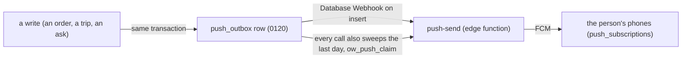

# 06 · Offline, sync and pushes

What this covers: what each phone keeps when there is no signal, how it gets fresh data, how a write survives bad signal, how the app itself stays current, and every push — who gets it, what sends it, and whether the app opens it.
Date: 2026-10-28
Status: **decided — Kevin took every recommended answer in §7 on 2026-10-28**

---

## 0. How to read this chapter

**Source.** The six role apps read on 2026-10-28 (`store.html`, `sales.html`, `buyer.html`, `manager.html`, `accounts.html`, `owner.html`; a line each for `worker.html`, `agent.html`, `supplier.html`), their service workers and native shells (`apps/<role>/`), and the push functions in a database built from `0001`–`0178`. Line numbers are of those files on that day.

**Every app is different.** Each app solved bad signal on its own, so most rows below have six answers. §7 asks Kevin for one; the shared core (phase 3) builds it once.

---

## 1. The phone's copy of the books

| App | Kept in | Key | Opens with no signal | Cleared at sign-out |
|---|---|---|---|---|
| Store | IndexedDB `ow-store`, store `snap` | `ow-store-snap2:<user>` | yes: draws the copy **before** checking the login (`store.html:1952-1958`) | no (5927) |
| Sales | localStorage | `ow-sales-snap:<user>` | yes, after the login is read (4833-4842) | every `ow-*-snap` (6816) |
| Buyer | localStorage | `ow-buyer-snap:<user>` | yes, after the login (1611-1621) | no (4804) |
| Manager | localStorage | `ow-manager-snap:` | yes, after the login (2199-2221) | its own (6326) |
| Accounts | localStorage | `ow-accounts-snap:` | yes, after the login (2277-2299) | no (4071) |
| Owner | localStorage | `ow-owner-snap:` | yes, after the login (1613-1635) | its own (3857) |
| Agent | localStorage | `agentOfflineCache` (`agent.html:5305`) | yes | — |

What a copy holds: the shop's live data as the app last read it, and when (`at`). Store says "Updating · saved HH:MM" once it is over 10 minutes old (2963); Sales says "No connection · prices from HH:MM · lines kept" (5100-5109); the others say only "Offline — showing what you last saw".

localStorage holds about 5 MB and fails silently when full; only Sales makes room, by dropping the other apps' copies (`sales.html:4020-4026`).

---

## 2. Getting fresh data

There is **no realtime**: no app subscribes to database changes (no `.channel(` or `postgres_changes` in any app). Every app asks again on a timer.

| App | Every | Reads | Back to the app after 30 s away | Signal comes back (`online`) |
|---|---|---|---|---|
| Store | 45 s | `store_live` (0166), the day's moving parts only; the full `store_snapshot` if that fails (1179-1188) | full reload (2047) | clears the offline mark only (5939) |
| Sales | 60 s | orders in the live window; chats every 15 s, presence every 20 s (5006-5014) | full reload (5015) | redraws (5114) |
| Buyer | 45 s | orders, trips, hand-offs, restock buys; keeps only the newest answer (858-866) | full reload (1735) | sends what is kept (6163) |
| Manager | 45 s | orders, trips, yard notes (1271-1276) | full reload (2334) | sends kept asks (1256) |
| Accounts | 90 s | orders, 2 days of cash, asks, hand-offs (1462-1470) | full reload (2408) | **full reload** (7035) |
| Owner | 90 s | orders, new log lines since the last read (1344-1350) | full reload (1701) | — |
| Worker | 60 s | its jobs (`worker.html:1000`) | — | — |
| Agent | 12 s | its orders (`agent.html:11677`) | — | — |

---

## 3. Writing on bad signal

| App | What is kept on the phone until sent | Sent again | A kept write the server refuses | Stale check |
|---|---|---|---|---|
| Store | reports and returns with photos (IndexedDB `outbox`, 1299-1322); picks, check-ins, counts, put-backs, labels (localStorage) | on `online`, after each refresh, on "Send now" (1324, 1283, 3020) | dropped, with a toast (1318) | **yes**: `store_patch_order` with `p_expect`; a clash says "Someone else just changed this order." and reloads it (2299-2330; 0162) |
| Sales | sourcing asks (`sx_src_outbox`), chat messages; **orders are not kept**: "No connection — the order is kept here. Slide again when you have signal." (8747) | on `online` and on open (10637-10648) | kept and tried again forever (10643) | no: `ow_patch_order` merges keys, the last write wins per key (3966-3970) |
| Buyer | trip answers and stop payments (`ow-buyer-trip:`, `ow-buyer-pay:`) | 1 s after a tap, on `online` (4006, 4033) | — | no: the trip's whole `lines` written back (4026); orders through `ow_patch_order` |
| Manager | balance asks only (`ow_mgr_balask_q`) | on `online` and open (3889-3904) | dropped, silently (3901) | no |
| Accounts | nothing: "No connection — nothing was changed. Try again with signal." (905) | — | — | no |
| Owner | nothing | — | — | — |
| Supplier | its answers (`K_QUEUE`, `supplier.html:544`) | on `online`: "Back online · everything sent" | kept, with a note (557-567) | — |

Store also holds writes that are hard to take back for 10 seconds with **Undo** (`heldWrite`, 988-998).

Words in use for the same thing: "No signal" (Store, Manager) and "No connection" (Sales, Accounts, Buyer); "Kept on this phone" and "kept here".

---

## 4. The app staying current

| How | Who | Detail |
|---|---|---|
| **Native live update** | all six phone apps, same code | every 30 min (**Manager: every 3 min**, `manager.html:125`), on resume, and 5 s after start, the app asks `omni-ware.vercel.app/<app>.html` (ETag); refuses a page under 100,000 characters or with no `</html>`; stores it and switches when the app next goes to the background, never in the middle of a task (`store.html:138-235`, `apps/*/src/transform.js`) |
| **Service worker** | Store only | `store-sw.js`: the page answered from the phone at once and fetched behind it; "Update ready · Reload" when it changed; Supabase never cached. The other apps' web versions cannot open without signal; their phone apps can. `agent-sw.js` and `supplier-sw.js` are for pushes only. |

---

## 5. The login with no signal

The Supabase client keeps the login on the phone (`sb-<ref>-auth-token`; Sales its own key, `ow-sales-auth`, 3590). A failed request for lack of signal keeps the person signed in; Store signs out only on a 401/403 or a login error (1969). No app handles a login that expires while offline.

---

## 6. Pushes

### 6a. How a push travels

- **Written with the hand-off**, in the same transaction, so a push is never sent for a write that failed, nor lost for one that landed (0120).
- **To whom**: one login (`to_user`), every login whose role holds a task (`to_task`), or a role (`to_role`); never the login that made the write; one per thing (a `dedupe` key).
- **Sent** by `push-send`, through Firebase (FCM); each row claimed by one call (`ow_push_claim`), tried up to 5 times within a day.
- **Other senders**, outside the outbox: `notify-worker` ("New order to prepare" to the packer, a webhook on `saved_quotes`), `notify-stock-count` (a finished stock take to every owner, admin and manager), `agent-nudge` (agents, web push and native), and the owner's digest at 19:00 (`ow_owner_digest`, pg_cron).

**Phones register** with Capacitor `PushNotifications` into `push_subscriptions`. Store asks only when the person turns Alerts on and has a staff row (5923, 2649); the others ask at start.

**A tap** reloads, then opens the push's page. With no signal the reload fails and nothing opens, in every app but Owner, which opens first (`store.html:2662`, `sales.html:4900`, `owner.html:1684`).

### 6b. Every push

To a task means every login whose role holds it (`role_tasks`). "Opens" = the receiving app has a page for the push; ✗ = it arrives, but a tap opens the app's start.

| Push | To | Sent by | Opens |
|---|---|---|---|
| `price.waits` | Manager (`price.approve`) | an order's price waits (0120, 0153) | ✓ |
| `credit.hold` | Manager (`credit.release`) | an order held for credit (0120, 0174 names old debt) | ✓ |
| `credit.ask` | Manager (`credit.release`) | the yard asks to let an unpaid order go (0156) | ✓ |
| `pick.short` | Manager (`pick.settle`) | a line packed short (0120) | ✓ |
| `order.delivered` | Manager (`invoice.make`) | an order delivered (0120) | ✓ |
| `invoice.held` | Manager (`price.approve`, `pick.settle` or `invoice.make`, by why) | the hourly run could not invoice (0139, 0169) | ✓ |
| `invoice.ask` | Manager (`invoice.void` / `credit_note.raise`) | a void or return asked (0131) | ✓ |
| `agent.change`, `agent.cancel` | Manager (`agent.change`) | an agent's ask (0120) | ✓ |
| `carton.ask` | Manager (`restock.hold`) | the Buyer asks for a carton's shelf part (0151) | ✓ |
| `trip.difference`, `trip.yard_note` | Manager (`trip.difference`) | the yard's count differs; the Buyer's yard note | ✓ |
| `stock.report` | Manager (`stock.writeoff`) | damaged or missing stock reported (0122) | ✓ |
| `store.extra` | Manager (`trip.difference`) | the yard found an item on the truck not on the list: keep it? (0157) | ✗ |
| `store.closed` | Manager (role) | the yard closed: what is out, what carries over (0157) | ✗ |
| `stock_count` (notify-stock-count) | owner, admin, Manager | a stock take done | ✗ in Manager; opens in Store |
| `price.decided` | the salesperson | the Manager decided the price | ✓ |
| `credit.decided` | the salesperson | credit released or held (0131) | ✓ |
| `price.changed` | the salesperson | a supplier line's price changed on an open order | ✓ |
| `line.dropped` | the salesperson | a line dropped from an order (0136) | ✓ |
| `item.switch` | the salesperson (or `quote.make`) | the Buyer switched an item | ✓ |
| `order.invoiced` | the salesperson, and Accounts (`invoice.send`) | an order invoiced (0138) | ✓ both |
| `invoice.ask.decided`, `payment.ask.decided` | who asked | the Manager or Accounts answered | ✓ |
| `request.listed` | who asked | Sourcing listed the item | ✓ |
| `chat.handed`, `chat.note`, `chat.reply_by_other` | the chat's salesperson | a chat handed, noted, answered by someone else (0170) | ✓ |
| `order.cancelled` | the salesperson, and the yard (`order.pick`) when it was packing | the Manager cancelled it (0177) | ✗ both |
| `customer.changed` | the salesperson who last sold to them | the Manager edited the customer (0158) | ✗ |
| `trip.short` | the salesperson (or `quote.make`) | a trip came back short for an order | ✗ |
| `order.buying` | Buyer (`trip.plan`) | an order entered Buying (0131) | ✓ |
| `supplier.answered` | Buyer (`supplier.confirm`) | a supplier answered in its app (0133) | ✓ |
| `restock.held`, `restock.released` | Buyer (`buy.restock`) | the Manager held or let go a restock line (0136) | ✓ |
| `store.restock` | Buyer (`buy.restock`) | the yard asks for more stock (0157) | ✓ |
| `carton.refused` | the Buyer who asked | the Manager said no to a carton (0158) | ✓ |
| `sourcing.found` | who asked (or `supplier.confirm`) | Sourcing found the item | ✓ |
| `trip.cash.ready` | the Buyer who asked | Accounts has the trip's cash ready | ✓ |
| `trip.sent`, `trip.taken`, `trip.cancelled` | the runner | a trip given to them, taken by someone else, called off (0150) | ✓ |
| `trip.back` | Store (`stock.receive`) | a trip on its way back | ✓ |
| `job.given` | the driver | a delivery given to them (0158) | ✓ |
| `credit.ask.decided`, `store.ask.decided`, `stock.report.decided` | who asked in the yard | the answer | ✓ |
| `store.handover` | the person handed to | the yard handed to them, with any half-done jobs (0157) | ✓ |
| `trip.cash`, `trip.cash.ask` | Accounts (`trip.cash`) | a trip's cash to count; the Buyer asks for cash | ✓ |
| `trip.own_money` | Accounts (`trip.cash`) | pay the Buyer back what they paid from their own money (0151, 0154) | ✗ |
| `bill.due`, `bill.paper` | Accounts (`bill.pay`, `bill.record`) | a supplier bill due; a paper bill handed in | ✓ |
| `payment.ask` | Accounts (`payment.edit`) | Sales asks to correct a payment (0130) | ✓ |
| `prices.confirm`, `sourcing.request`, `sourcing.dropped`, `sourcing.fix`, `store.new_item` | Sourcing | the day's prices, asks, fixes | not checked (`sourcing.html` not read for this) |
| `owner.digest` | the owner | 19:00, the day's log | ✓ |

---

## 7. Decided (Kevin, 2026-10-28)

| # | The apps differ on | Decided (the shared core builds it once) |
|---|---|---|
| Q1 | Where the copy lives: IndexedDB (Store) or localStorage (five), which fails silently when full | **IndexedDB for every app**, one store per login |
| Q2 | Opening on bad signal: Store draws the copy first; the others wait for the login | **Draw the copy first**, then check |
| Q3 | Refresh every 45, 60 or 90 s; only Store reads a small "live" function | **One live read per role on the server** (like `store_live`), every 45 s while the app is open |
| Q4 | Which writes survive bad signal: Store and Buyer keep theirs, Sales keeps some (not orders), Accounts and Owner none | **Every write goes through one outbox** on the phone, sent in order when signal comes back |
| Q5 | A kept write the server refuses: dropped (Store, Manager), retried forever (Sales), kept with a note (Supplier) | **Kept, shown with the server's reason**, until the person fixes or discards it |
| Q6 | Only Store checks for a clash; the others let the last write win per key | **Every write says what it saw** (`p_expect`), and a clash reloads and asks again |
| Q7 | "No signal" or "No connection"; "Kept on this phone" or "kept here" | **"No signal"** and **"Kept on this phone"** (the yard's words), into `docs/audit/GLOSSARY.md` |
| Q8 | A tapped push with no signal opens nothing (all but Owner) | **Open from the copy**, refresh behind |
| Q9 | 8 pushes reach an app with no page for them (§6b ✗) | **Each push has its page** in the app it goes to; a test pairs them |
| Q10 | `notify-stock-count` pushes the owner, though decision-rights says the owner gets a log, never a queue | **Manager only**; the owner sees it in the log |
| Q11 | Manager's "Kept on this phone" for an invoice is held only in memory: it is lost if the app closes (`manager.html:5070`, `5115`) | **The new Manager fixes it**, through the one outbox (Q4); the old app is frozen |
| Q12 | Sign-out keeps the copy in Store, Buyer and Accounts | **Sign-out clears the copy** (a shared phone in the yard) |
| Q13 | The app checks for a new page every 3 min (Manager) or 30 min (the rest) | **30 min**, and on resume |
| Q14 | Only Store's web version opens with no signal | **A service worker for every app**, as Store's |
